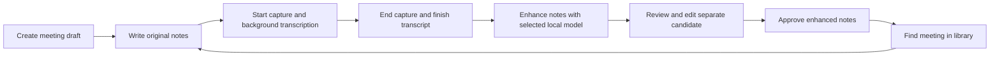
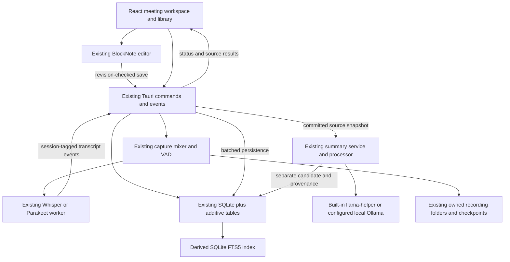

# Meetily Community Edition: Meeting Experience Upgrade

Planning document; no feature implementation is authorized by this document.

Implementation was subsequently authorized on 2026-10-13. See
[P0 implementation handoff](p0-implementation-handoff.md) for current changes,
verification and pending acceptance gates. The audit and acceptance criteria
below remain the planning record; unchecked native gates are not implied passed.

An additional whole-app visual design goal was authorized on 2026-10-15:
[UI design upgrade](ui-design-upgrade.md). It adds a warm light theme, sage
accents and selective glass in a separate workstream; the original MVP's
redesign exclusion and its functional acceptance record remain historical scope.

## Owner closeout — 17 October 2026

**Long-recording test: APPROVED.** The project owner confirmed personal manual
verification and explicitly accepted the test on 17 October 2026. Long-recording
acceptance is closed for the retained app; existing automated run receipts keep
their recorded results and boundaries. No additional duration, provider or
performance measurements were supplied with this manual sign-off.

The owner is satisfied with the current app. Preserve the installed app and
defer Windows acceptance as **unverified**, as requested. The preview remains
an unpublished draft. This closes the current work at the owner's requested
scope; other recorded acceptance limitations remain unchanged.

The 15 October status and recommendations below are historical. Their proposed
45-minute/four-hour runs and continued Windows work are superseded by this
closeout. Further development or deferred verification requires a new owner
request. See [release readiness](../v0-release.md#owner-closeout--17-october-2026).

## Current project status — 15 October 2026

This status was reconciled against the current handoffs and evidence receipts,
including the subsequent UI installation and latest automated capture
verification. Sections 1–14 retain the original
audit, requirements and task contracts; the delivery/acceptance tracker in
Section 9 now distinguishes implemented work from pending acceptance. The
checkout is still based on `a2cb62e`, with the implementation in the dirty
working tree. This refresh changes documentation only and starts no new
implementation, recording, installation or release work.

| Workstream | Latest delivered evidence | Remaining acceptance |
| --- | --- | --- |
| Notes, recording identity and recovery | Durable originals, acknowledged saves, shared workspace, session-aware persistence, append-to-meeting and continuous transcript offsets are implemented. [P0 handoff](p0-implementation-handoff.md) and [recording continuity](../recording-continuation.md). | Full native crash/device/platform matrix and latest-revision long-session responsiveness. |
| Enhancement and review | Separate original/candidate/approved documents, source snapshots, templates and review are implemented. E08 completed 96 before/corrected real-model jobs. [Evaluation](enhancement-quality-evaluation.md). | **AC07 remains failed:** both evaluated model configurations are unsuitable; semantic remediation and independent human acceptance remain open. |
| Library, search, export and deletion | Metadata/FTS/library/deletion implemented; L05 complete Markdown/JSON export delivered. [Export evidence](evidence/meeting-export/README.md). | Large-library ranking/latency, Windows Save/locked-file handling and native retention/deletion acceptance. |
| Q01 workflow automation | Passing isolated macOS native IPC, saves, restart, deterministic enhancement, search, export/deletion and default/fallback-switch evidence. [Q01 evidence](evidence/workflow-automation/README.md). | Physical capture, real-model semantics and other platforms are separate gates. |
| Q02 native continuity | Active. Short useful-processing observations pass. Fresh isolated macOS builds passed all eight source-replay cases across both providers; ten sessions retained all 35 final passages through Stop/export. Short actual system capture, native pause/resume transitions and two recordings appended to one meeting passed with both providers. [Capture verification](evidence/capture-verification-20261015/README.md) and [Q02 handoff](q02-native-validation-handoff.md). | Human microphone speech and distinct simultaneous physical sources, extended pause exclusion, independent source-fidelity review, latest 45-minute/four-hour AC05 runs, failure/recovery/upgrade scenarios and Windows/minimum-platform evidence. |
| UI design and interaction hardening | D01–D05 and compact source icons delivered; 166 frontend tests/641 assertions, build and subsequent TypeScript passed. Isolated macOS checks passed 91 layout cases, 34 design cases, eight interaction scenarios and 122 continuous resize steps. [Interaction evidence](evidence/interaction-stress/README.md). | Human aesthetic acceptance, Windows rendering and physical capture during resizing/long sessions remain open. |
| Installation | The verified UI build is installed at `/Applications/meetily.app` with identifier `com.meetily.ai`. Latest verification matched all 15 bundle files to the newest archived release and preserved the installed app, models and production library. Sixteen old copies were moved to Trash and eight generated bundles archived. [Installation record](evidence/ui-install-20261015/README.md). | Capture verification ran in fresh isolated test packages; direct installed-production capture, signed-release, previous-release upgrade and long-run acceptance remain open. |
| **QA Regression Verification** | **VERIFIED PASS (15 October 2026).** Comprehensive audit confirmed zero regressions across all delivered pillars: 166 frontend tests/641 assertions passed, TypeScript clean compile, 361 native Rust tests passed (1 known Apple Silicon built-in mic classification test failure, 8 documented opt-in tests ignored). | Ongoing gating for future duration runs, platform targets, and pipeline enhancements. |
| **ASR & UI Pipeline Reinforcement** | R10–R13 / U12–U15 implemented: verified overlap/gap handling, durable bounded source inbox for both providers/routes, blocking checkpoint saver with drain acknowledgments and raw-tail recovery, soft-knee mixing, row-level transcript updates, immediate scroll anchors, shared session guards and truthful backlog status. [Reinforcement handoff](pipeline-reinforcement-handoff.md). | Focused regressions and short isolated replay are recorded separately from acceptance. Latest 45-minute/four-hour AC05, foreground paint, physical capture/fidelity and Windows gates remain open. |

**Best next available automated task: complete the latest-revision 45-minute
Q02 normal workload with continuous large-v3, then Parakeet, before the four-hour
AC05 stress run.** The user selected automated checks only for the latest
capture verification. Its short source matrix, persistence and continuation
checks are complete; repeating that smoke is not the next assignment unless
code changes or a new failure justify it. Human microphone speech, independent
listening review and extended physical pause exclusion remain separate open
gates and are not waived by proceeding with available automated duration work.

Recommended execution order within Q02:

1. **Latest-revision duration and editor acceptance — next automated assignment.**
   Complete the 45-minute normal workloads before scheduling the four-hour
   stress run. Start with continuous large-v3, then Parakeet. Measure real
   foreground editing, acknowledgments, native/WebView memory, save/render
   queues, dropped chunks, backlog and Stop reconciliation against AC05. The
   prior Whisper 45-minute replay predates eager admission; Parakeet's aborted
   34-minute run and the unstarted four-hour run do not count as passes. Label
   replay as replay; it cannot close an actual 45-minute physical-meeting gate.
2. **Remaining fidelity and physical-capture acceptance — open.** Use known
   human microphone speech and distinct simultaneous system speech when an
   operator is available. Exercise speech during an extended native pause,
   resume, Stop and appended sessions. Independently review omissions,
   repetitions, names/Unicode and window/Stop boundaries against source audio.
   The completed automated comparison still shows authored-reference word
   differences: Whisper 6.1–11.1%, Parakeet 7.4–9.1%; exact retained PCM and
   emitted-passage retention do not establish complete speech recognition.
   Fix only demonstrated Q02 defects; do not change references to fit output.
3. **Remaining native/platform matrix.** Complete tray Stop/Quit, permission
   denial, disconnect, forced termination/recovery, previous-release upgrade
   and Windows x64/minimum-target checks. Unavailable hardware remains an
   explicit pending gate while available macOS work proceeds.

Keep the user's accepted slower-than-real-time large-Whisper processing
priority: admit fresh audio whenever the worker is free, reuse the resident
decoder and avoid unchanged preview work. Report speed/backlog/display/Stop
metrics; the earlier strict RTF/legacy-latency comparison stays a failed
historical result. AC05 responsiveness, source retention and fidelity are
separate obligations and have not been relaxed. Continuous Whisper stays
enabled by default, with the saved Beta fallback applying to the next session.

After Q02 acceptance, Q03 locality/retention verification becomes eligible.
E08 semantic remediation remains a separate assignment and release blocker;
Q04 requires Q01–Q03 **and all MVP acceptance gates**, including AC07. Neither
Q03/Q04 nor E08 remediation is started by this planning refresh. The known
microphone-classifier failure, eight ignored native tests and unresolved
ESLint setup remain recorded; the latest receipts are not an unfiltered green
native suite or a lint pass.

Earlier test/build bundles live under
`target/archived-app-bundles.noindex/20261015T103927/`. Latest capture verification
rebuilt `Meetily Recording Test.app` and `Meetily Q02 Test.app` at the normal
debug/release bundle paths; their hashes are in its evidence receipt. Verify
the exact artifact before reproducing a run; never substitute the production
identity or reuse an older binary as latest-revision evidence. This planning
update starts no new recording or duration run.

## Original audit baseline — 13 October 2026

- Audit date: 13 October 2026.
- Repository: [Zackriya-Solutions/meetily](https://github.com/Zackriya-Solutions/meetily).
- Audited local revision: `a2cb62e827da7ef59f65064c97233efb2313878e`, commit subject `Release v0.4.1`; package and Tauri versions are `0.4.1`.
- The working tree was clean at audit start. Findings describe this checkout, not an assumed latest upstream release. No fetch, build, application launch, dependency installation, or inspection of a user's live meeting database was performed.
- Evidence comes from active source, migrations, manifests, tests, and workflows. Documentation and comments were checked against callers and command registration. Native behavior and model quality remain unverified.

## 1. Executive Summary

**Extend Meetily's existing desktop application into one note-first meeting workspace.** Keep its Tauri/Rust core, Next.js/React UI, BlockNote editor, SQLx/SQLite database, audio pipeline, local Whisper/Parakeet transcription, Ollama integration, and built-in local summary engine.

Meetily already records and transcribes meetings, retains meeting history, edits generated summaries, accepts summary instructions, loads templates, and searches titles and transcript text. It does **not** currently connect those capabilities to durable original notes written during a meeting. A `meeting_notes` migration exists, but no active note repository, save/load command, or live notes editor uses that table. The apparent standalone notes route contains sample data.

The most consequential dependencies are an early, stable meeting ID; reliable original-note saves; recording finalization that reuses that ID; and enhancement candidates that cannot replace original notes or approved edits. Solve these before expanding the library.

Recommended implementation order:

1. **M0 — Validate the baseline and storage contracts.** Establish native recording behavior, test commands, SQLite capabilities, and migration fixtures.
2. **M1 — Durable meeting drafts and notepad.** Create a meeting before capture, reuse BlockNote, and add acknowledged autosave and recovery.
3. **M2 — Connect existing background transcription and show audio sources.** Keep editing available through start, pause, stop, draining, and recovery; attach transcripts to the existing meeting and label each passage as Microphone or System audio when its capture origin is preserved.
4. **M3 — Transcript-grounded enhancement and review.** Combine notes and transcripts through existing local inference, preserve sources, and review separate candidates.
5. **M4 — Extend the meeting library.** Add metadata, local full-text search, filters, export, and coordinated deletion.
6. **M5 — Native workflow validation and stabilization.** Complete long-session, migration, privacy, and release checks.

The MVP includes all three core features, live transcript audio-source indicators, Markdown/JSON export, the five requested template choices, and reliable local storage. Semantic search, cloud synchronization, collaboration, new ASR development, and unrelated redesign remain outside it. Estimated engineering effort is **36–56 developer-days**, including milestone tests but excluding access delays and major pre-existing defects; allow approximately **9–14 working weeks** for one developer with contingency. Audio-source routing, persistence, and badge tasks add an estimated 3–5 days. These are planning estimates, not measured delivery commitments.

## 2. Current State of Meetily

**The core recording, transcription, summary, and history services exist; the original-note workflow needs wiring and reliability work.** Source-level implementation is distinguished below from successful execution on a device.

Classification meanings:

- **Already implemented:** an active caller and implementation exist for the stated capability.
- **Partially implemented:** reusable functionality exists, but part of the requirement is absent or incomplete.
- **Missing:** no active implementation was located in the audited application paths; a schema, comment, dependency, or sample screen is insufficient.
- **Requires verification:** source inspection cannot settle behavior, compatibility, or quality.

### 2.1 Architecture and source map

The supported application is a static-export Next.js 14/React 18/TypeScript frontend inside Tauri 2, with a Rust 2021 core. Tailwind, Radix/shadcn components, BlockNote `0.36.0`, and TanStack React Virtual are already dependencies. SQLx `0.8` stores records in SQLite. Tokio tasks and Tauri commands/events coordinate native work. The workspace also builds a `llama-helper` sidecar using `llama-cpp-2`.

The Python/FastAPI, Docker, and standalone Whisper server under `backend/` are explicitly archived in [backend/README.md](../../backend/README.md) and [CLAUDE.md](../../CLAUDE.md). Existing frontend variables containing old localhost server addresses do not establish a supported external backend: meeting commands invoke Rust directly. The `electron/main.js` value in `package.json` also does not establish an active Electron architecture.

The following source groups identify existing files. Later tasks refer to these groups and name any new files explicitly.

| Group | Existing files and responsibilities |
| --- | --- |
| S1: application entry and build | [frontend/package.json](../../frontend/package.json), [frontend/next.config.js](../../frontend/next.config.js), [Cargo.toml](../../Cargo.toml), [frontend/src-tauri/Cargo.toml](../../frontend/src-tauri/Cargo.toml), [frontend/src-tauri/src/lib.rs](../../frontend/src-tauri/src/lib.rs), [frontend/src-tauri/tauri.conf.json](../../frontend/src-tauri/tauri.conf.json), [llama-helper/Cargo.toml](../../llama-helper/Cargo.toml). Commands register in `lib.rs`; frontend output is static. |
| S2: live meeting UI and recording lifecycle | [frontend/src/app/page.tsx](../../frontend/src/app/page.tsx), [frontend/src/app/_components/TranscriptPanel.tsx](../../frontend/src/app/_components/TranscriptPanel.tsx), [frontend/src/app/_components/StatusOverlays.tsx](../../frontend/src/app/_components/StatusOverlays.tsx), [frontend/src/components/RecordingControls.tsx](../../frontend/src/components/RecordingControls.tsx), [frontend/src/hooks/useRecordingStart.ts](../../frontend/src/hooks/useRecordingStart.ts), [frontend/src/hooks/useRecordingStop.ts](../../frontend/src/hooks/useRecordingStop.ts), [frontend/src/services/recordingService.ts](../../frontend/src/services/recordingService.ts). |
| S3: shared recording/transcript state | [frontend/src/contexts/RecordingStateContext.tsx](../../frontend/src/contexts/RecordingStateContext.tsx), [frontend/src/contexts/TranscriptContext.tsx](../../frontend/src/contexts/TranscriptContext.tsx), [frontend/src/services/transcriptService.ts](../../frontend/src/services/transcriptService.ts), [frontend/src/components/RecordingStatusBar.tsx](../../frontend/src/components/RecordingStatusBar.tsx), [frontend/src/components/VirtualizedTranscriptView.tsx](../../frontend/src/components/VirtualizedTranscriptView.tsx), [frontend/src/hooks/usePaginatedTranscripts.ts](../../frontend/src/hooks/usePaginatedTranscripts.ts). |
| S4: editor and document compatibility | [frontend/src/components/BlockNoteEditor/Editor.tsx](../../frontend/src/components/BlockNoteEditor/Editor.tsx), [frontend/src/components/AISummary/BlockNoteSummaryView.tsx](../../frontend/src/components/AISummary/BlockNoteSummaryView.tsx), [frontend/src/components/AISummary/index.tsx](../../frontend/src/components/AISummary/index.tsx), [frontend/src/lib/blocknote-markdown.ts](../../frontend/src/lib/blocknote-markdown.ts), [frontend/src/lib/summary-content.ts](../../frontend/src/lib/summary-content.ts), [frontend/src/types/index.ts](../../frontend/src/types/index.ts). |
| S5: saved meeting UI | [frontend/src/app/meeting-details/page.tsx](../../frontend/src/app/meeting-details/page.tsx), [frontend/src/app/meeting-details/page-content.tsx](../../frontend/src/app/meeting-details/page-content.tsx), [frontend/src/components/MeetingDetails/MeetingDetailsSplitView.tsx](../../frontend/src/components/MeetingDetails/MeetingDetailsSplitView.tsx), [frontend/src/components/MeetingDetails/SummaryPanel.tsx](../../frontend/src/components/MeetingDetails/SummaryPanel.tsx), [frontend/src/components/MeetingDetails/TranscriptPanel.tsx](../../frontend/src/components/MeetingDetails/TranscriptPanel.tsx), [frontend/src/hooks/meeting-details/useMeetingData.ts](../../frontend/src/hooks/meeting-details/useMeetingData.ts). |
| S6: database and native meeting API | [frontend/src-tauri/src/database/manager.rs](../../frontend/src-tauri/src/database/manager.rs), [frontend/src-tauri/src/database/setup.rs](../../frontend/src-tauri/src/database/setup.rs), [frontend/src-tauri/src/database/models.rs](../../frontend/src-tauri/src/database/models.rs), [frontend/src-tauri/src/database/repositories/meeting.rs](../../frontend/src-tauri/src/database/repositories/meeting.rs), [frontend/src-tauri/src/database/repositories/transcript.rs](../../frontend/src-tauri/src/database/repositories/transcript.rs), [frontend/src-tauri/src/api/api.rs](../../frontend/src-tauri/src/api/api.rs), [frontend/src/services/storageService.ts](../../frontend/src/services/storageService.ts), [frontend/src-tauri/migrations/20251223000000_add_meeting_notes.sql](../../frontend/src-tauri/migrations/20251223000000_add_meeting_notes.sql). |
| S7: history and search UI | [frontend/src/components/Sidebar/index.tsx](../../frontend/src/components/Sidebar/index.tsx), [frontend/src/components/Sidebar/SidebarProvider.tsx](../../frontend/src/components/Sidebar/SidebarProvider.tsx). |
| S8: summary orchestration and persistence | [frontend/src/hooks/meeting-details/useSummaryGeneration.ts](../../frontend/src/hooks/meeting-details/useSummaryGeneration.ts), [frontend/src-tauri/src/summary/commands.rs](../../frontend/src-tauri/src/summary/commands.rs), [frontend/src-tauri/src/summary/service.rs](../../frontend/src-tauri/src/summary/service.rs), [frontend/src-tauri/src/summary/processor.rs](../../frontend/src-tauri/src/summary/processor.rs), [frontend/src-tauri/src/summary/llm_client.rs](../../frontend/src-tauri/src/summary/llm_client.rs), [frontend/src-tauri/src/database/repositories/summary.rs](../../frontend/src-tauri/src/database/repositories/summary.rs). |
| S9: instructions, templates, and copy | [frontend/src/hooks/meeting-details/useTemplates.ts](../../frontend/src/hooks/meeting-details/useTemplates.ts), [frontend/src/components/MeetingDetails/SummaryGeneratorButtonGroup.tsx](../../frontend/src/components/MeetingDetails/SummaryGeneratorButtonGroup.tsx), [frontend/src/hooks/meeting-details/useCopyOperations.ts](../../frontend/src/hooks/meeting-details/useCopyOperations.ts), [frontend/src-tauri/src/summary/template_commands.rs](../../frontend/src-tauri/src/summary/template_commands.rs), [frontend/src-tauri/src/summary/templates/types.rs](../../frontend/src-tauri/src/summary/templates/types.rs), [frontend/src-tauri/src/summary/templates/loader.rs](../../frontend/src-tauri/src/summary/templates/loader.rs), [frontend/src-tauri/templates/standard_meeting.json](../../frontend/src-tauri/templates/standard_meeting.json). |
| S10: independent model configuration | [frontend/src/contexts/ConfigContext.tsx](../../frontend/src/contexts/ConfigContext.tsx), [frontend/src/components/ModelSettingsModal.tsx](../../frontend/src/components/ModelSettingsModal.tsx), [frontend/src/components/TranscriptSettings.tsx](../../frontend/src/components/TranscriptSettings.tsx), [frontend/src-tauri/src/database/repositories/setting.rs](../../frontend/src-tauri/src/database/repositories/setting.rs), [frontend/src-tauri/src/ollama/ollama.rs](../../frontend/src-tauri/src/ollama/ollama.rs), [frontend/src-tauri/src/ollama/metadata.rs](../../frontend/src-tauri/src/ollama/metadata.rs), [frontend/src-tauri/src/summary/summary_engine/client.rs](../../frontend/src-tauri/src/summary/summary_engine/client.rs), [frontend/src-tauri/src/summary/summary_engine/sidecar.rs](../../frontend/src-tauri/src/summary/summary_engine/sidecar.rs), [frontend/src-tauri/src/summary/summary_engine/models.rs](../../frontend/src-tauri/src/summary/summary_engine/models.rs). |
| S11: native capture, processing, and saving | [frontend/src-tauri/src/audio/recording_commands.rs](../../frontend/src-tauri/src/audio/recording_commands.rs), [frontend/src-tauri/src/audio/recording_manager.rs](../../frontend/src-tauri/src/audio/recording_manager.rs), [frontend/src-tauri/src/audio/pipeline.rs](../../frontend/src-tauri/src/audio/pipeline.rs), [frontend/src-tauri/src/audio/transcription/worker.rs](../../frontend/src-tauri/src/audio/transcription/worker.rs), [frontend/src-tauri/src/audio/transcription/engine.rs](../../frontend/src-tauri/src/audio/transcription/engine.rs), [frontend/src-tauri/src/audio/recording_saver.rs](../../frontend/src-tauri/src/audio/recording_saver.rs), [frontend/src-tauri/src/audio/incremental_saver.rs](../../frontend/src-tauri/src/audio/incremental_saver.rs), [frontend/src-tauri/src/audio/recording_preferences.rs](../../frontend/src-tauri/src/audio/recording_preferences.rs). |
| S12: recovery and transcription replacement | [frontend/src/services/indexedDBService.ts](../../frontend/src/services/indexedDBService.ts), [frontend/src/hooks/useTranscriptRecovery.ts](../../frontend/src/hooks/useTranscriptRecovery.ts), [frontend/src/components/TranscriptRecovery/TranscriptRecovery.tsx](../../frontend/src/components/TranscriptRecovery/TranscriptRecovery.tsx), [frontend/src-tauri/src/audio/retranscription.rs](../../frontend/src-tauri/src/audio/retranscription.rs), [frontend/src-tauri/src/audio/import.rs](../../frontend/src-tauri/src/audio/import.rs), [frontend/src-tauri/src/audio/decoder.rs](../../frontend/src-tauri/src/audio/decoder.rs). |
| S13: platform and privacy controls | [frontend/src-tauri/src/audio/devices/platform/windows.rs](../../frontend/src-tauri/src/audio/devices/platform/windows.rs), [frontend/src-tauri/src/audio/devices/platform/macos.rs](../../frontend/src-tauri/src/audio/devices/platform/macos.rs), [frontend/src-tauri/src/audio/capture/backend_config.rs](../../frontend/src-tauri/src/audio/capture/backend_config.rs), [frontend/src-tauri/src/audio/capture/core_audio.rs](../../frontend/src-tauri/src/audio/capture/core_audio.rs), [frontend/src-tauri/src/audio/permissions.rs](../../frontend/src-tauri/src/audio/permissions.rs), [frontend/src-tauri/src/tray.rs](../../frontend/src-tauri/src/tray.rs), [frontend/src/components/AnalyticsProvider.tsx](../../frontend/src/components/AnalyticsProvider.tsx), [frontend/src/components/ComplianceNotification.tsx](../../frontend/src/components/ComplianceNotification.tsx), [frontend/src-tauri/src/analytics/analytics.rs](../../frontend/src-tauri/src/analytics/analytics.rs). |
| S14: build and release validation | [docs/BUILDING.md](../../docs/BUILDING.md), [frontend/README.md](../../frontend/README.md), [frontend/scripts/tauri-auto.js](../../frontend/scripts/tauri-auto.js), [frontend/src-tauri/build.rs](../../frontend/src-tauri/build.rs), [frontend/src-tauri/build/onnxruntime.rs](../../frontend/src-tauri/build/onnxruntime.rs), [frontend/src-tauri/build/ffmpeg.rs](../../frontend/src-tauri/build/ffmpeg.rs), [.github/workflows/build.yml](../../.github/workflows/build.yml), [.github/workflows/release.yml](../../.github/workflows/release.yml), [.github/workflows/build-test.yml](../../.github/workflows/build-test.yml), [.github/workflows/build-devtest.yml](../../.github/workflows/build-devtest.yml), [.github/verify-portable-ggml.test.cjs](../../.github/verify-portable-ggml.test.cjs). |

### 2.2 Existing workflows and limits

| Audit area | Classification | Confirmed implementation and its boundary |
| --- | --- | --- |
| Architecture | Already implemented | S1 exposes native commands/events and packages a static UI with Rust services and sidecars. No new web server is needed. |
| Recording and live transcription | Already implemented | S2/S3/S11 start mic/system capture, mix audio, route VAD speech to ASR workers, emit `transcript-update`, expose pause/resume/stop, and update tray/state. Successful native capture remains a verification item. |
| Live transcript audio-source indicators | Partially implemented | Capture chunks distinguish `DeviceType::Microphone` and `DeviceType::System`, and SQLite has a nullable `transcripts.speaker` column. However, `pipeline.rs` mixes both streams before VAD/ASR and tags mixed chunks with the Microphone placeholder; `transcription/worker.rs` emits `source: "Audio"`. The frontend drops that field when constructing displayed transcripts and renders no source badge. Reliable per-passage attribution needs source-preserving routing and end-to-end data wiring. |
| Live original notes | Partially implemented | S4 has a reusable rich-text editor, currently used for generated summaries. S6 has `meeting_notes`, but the active source contains no note CRUD caller or repository. `frontend/src/app/notes/[id]/page.tsx` is hard-coded sample data. |
| AI summary generation | Already implemented | S8 starts a native background job, chunks long input for local providers, supports instructions/templates, cleans model reasoning, handles language preferences, and supports cancellation. Input is transcript text plus optional context; original notes are not a distinct input. |
| AI review and retention | Partially implemented | S4/S5 edit/save generated Markdown, BlockNote JSON, and legacy summaries. S8 backs up the previous result during regeneration and restores it on failure/cancellation; successful completion replaces it and clears the backup. This is not approved-version preservation. |
| Meeting history and storage | Already implemented | S6 creates SQLite meeting/transcript rows transactionally, lists meetings, loads details, paginates transcripts, and updates titles/summaries. The normal transcript save creates a new `meeting-UUID` after recording; there is no draft-creation API. |
| Search | Partially implemented | S7 calls `api_search_transcripts`; S6 executes `LOWER(t.transcript) LIKE ?` and produces snippets. Sidebar results combine transcript IDs with title substring matches. No FTS index, original-note search, metadata filters, or paginated meeting-list API was located. |
| Local LLMs and independent configuration | Already implemented | S10 separates summary `settings` from `transcript_settings`. Ollama has endpoint configuration/model discovery/context metadata. Built-in AI uses local GGUF models through `llama-helper`. Neither requires a cloud provider. |
| ASR providers and models | Already implemented | Active recording readiness/engine code accepts `parakeet` and `localWhisper`. Other provider names in settings columns or commented UI are not evidence of supported live cloud ASR. Preserve the two active local providers and their catalogs. |
| Windows/macOS platform implementations | Partially implemented | Windows uses CPAL/WASAPI output loopback paths. macOS includes Core Audio taps and ScreenCaptureKit selection; `AudioCaptureBackend::default()` selects Core Audio on macOS. Release workflows build Windows x64 and macOS Apple Silicon. Intel Mac support and minimum macOS behavior require verification. |
| Recovery | Partially implemented | S11 saves audio checkpoints and transcript JSON; S12 persists live transcripts/metadata in IndexedDB and offers recovery. These paths do not save original notes. Recovery/cache retention is limited and identities differ from final SQLite records. |
| Export and deletion | Partially implemented | S9 copies summaries/transcripts to the clipboard; S11 writes recording/transcript artifacts. No complete note/record file-export workflow was located. `api_delete_meeting` calls the database repository only; it does not delete recording folders or IndexedDB recovery data. |
| Tests, builds, and releases | Partially implemented | Existing frontend and inline Rust tests cover several relevant units; build/release workflows exist. No native end-to-end meeting suite or calls to the frontend/Rust test suites were located in the audited workflow files. Nothing was executed in this planning audit. |

### 2.3 Model and platform details to preserve

- **Whisper:** `frontend/src-tauri/src/config.rs` defines `tiny`, `base`, `small`, `medium`, `large-v3-turbo`, `large-v3`; `tiny/base/small-q5_1`; and `medium/large-v3-turbo/large-v3-q5_0`. The default Whisper selection is `large-v3-turbo`. Do not replace this catalog or its download/readiness logic.
- **Parakeet:** `frontend/src-tauri/src/parakeet_engine/parakeet_engine.rs` defines `parakeet-tdt-0.6b-v3-int8` and `parakeet-tdt-0.6b-v2-int8`. Fresh database setup defaults to v3 int8. Catalog descriptions are not evidence of language accuracy or meeting performance on another machine.
- **Built-in summary models:** S10 catalogs `qwen3.5:2b`, `qwen3.5:4b`, `gemma3:4b`, and `gemma3:1b`. Fresh setup chooses a system recommendation with a `qwen3.5:2b` fallback. Ollama can use separately configured installed models.
- **Optional external summary providers:** `LLMProvider` in `summary/llm_client.rs` supports OpenAI, Claude, Groq, OpenRouter, and custom OpenAI-compatible endpoints in addition to Ollama/built-in AI. A custom endpoint or Ollama model/provider name alone does not guarantee processing stays on the device.
- **Windows builds:** target-specific Cargo defaults differ from packaged releases. `.github/workflows/build.yml` adds Vulkan for Windows; `docs/BUILDING.md` states packaged Windows builds require AVX2 x64 CPUs. Preserve portable GGML checks, bundled ONNX Runtime, and CPU fallback behavior where validated. Do not claim automatic CUDA support in the standard installer.
- **macOS builds:** Cargo enables Metal/CoreML for Whisper; release builds target `aarch64-apple-darwin`. Core Audio source describes taps/Audio Capture permission on macOS 14.4+. Older documentation mentions ScreenCaptureKit/BlackHole; do not treat a virtual driver as a universal requirement. Verify the supported OS/backend matrix before promising broader compatibility.
- **Permissions:** `audio/permissions.rs::check_screen_recording_permission()` currently returns true on macOS while relying on the tap's permission prompt. That return value alone does not prove system audio is available. Validate actual signal capture and denial behavior.
- **Close behavior:** `lib.rs` hides the main window on `CloseRequested`; closing the window is not the same as quitting. Native acceptance must cover hide/reopen, tray stop, explicit quit, and process termination separately.

### 2.4 Existing validation assets

`frontend/tests/lib/` includes BlockNote conversion, summary parsing, transcription readiness, analytics, language preferences, empty states, and onboarding model checks. `frontend/tests/hooks/` includes summary generation/polling, transcript pagination, and meeting-route refresh checks. Most use Bun and React Test Renderer; `onboarding-summary-model.test.mjs` uses Node assertions and TypeScript transpilation. `package.json` has build/lint commands but no test script.

Inline Rust tests exist in summary commands/service/processor/client/templates, summary repository, ASR engines, decoder/import/retranscription, incremental saver, transcription workers, and audio/platform helpers. Some require FFmpeg, audio fixtures, device access, or explicitly ignored/manual execution; their presence is not a passing test result.

Platform scripts include `frontend/clean_run.sh`, `clean_build.sh`, Windows `.bat` equivalents, GPU helpers, and `scripts/tauri-auto.js`. Build scripts may download/bundle FFmpeg or native runtime artifacts. GitHub workflows are largely manually dispatched; a workflow called “Build Test” is a package build, not evidence that application tests run. The release workflow creates a draft release, builds signed macOS/Windows artifacts through `build.yml`, and uses Tauri updater artifacts. Preserve this release path; add test gates before it in subsequent implementation work.

## 3. Gap Analysis

**Most work connects existing services and protects user-authored content; it does not require a new recording or AI platform.** The matrix below is the requirements traceability matrix. S1–S14 resolve to actual files in Section 2; task IDs resolve to concrete implementation sessions in Section 9; acceptance IDs resolve to Section 11.

| Requirement | Existing implementation/status | Proposed change | Relevant files | Development task | Acceptance criteria |
| --- | --- | --- | --- | --- | --- |
| W01: one note-first workflow | Missing: live home is transcript-first; saved detail is transcript/summary split | Shared workspace for draft, live, review, and saved meeting | S2 `app/page.tsx`; S5 `MeetingDetailsSplitView.tsx` | N05, R03, E06 | AC01, AC03, AC06 |
| W02: rich-text/Markdown-compatible notes | Partially implemented: BlockNote edits summaries | Reuse editor; save native blocks and derived Markdown separately from summary | S4 `Editor.tsx`, `blocknote-markdown.ts`; S6 notes migration | N03–N05 | AC01, AC02 |
| W03: autosave and crash recovery | Missing for notes; transcript recovery exists | Revision-checked SQLite saves, visible acknowledgment, retained drafts | S6 `manager.rs`; S12 recovery; new note repository/hook | N01–N04, R04 | AC02, AC04, AC09 |
| W04: background transcription during editing | Partially implemented: native ASR is asynchronous; no live notepad | Connect existing event stream without remounting editor or covering it | S2/S3/S11 | R01–R05 | AC03, AC05 |
| W05: collapsible transcript | Partially implemented: resizable saved split view; full-width live panel | Secondary panel, collapsed by default, with independent scroll | S2 `TranscriptPanel.tsx`; S5 split view | N05, R03 | AC01, AC05 |
| W06: recording/transcription indicators and controls | Already implemented at source level | Reuse status/context/tray; distinguish capture, pause, backlog, failure, and saved state | S3, S11, S13 `tray.rs` | R03, R05 | AC03, AC10 |
| W07: title, date, participants, tags | Partially implemented: title and created/updated dates; no participant/tag storage | Add meeting metadata and manual participant/tag entry; keep unknowns empty | S6 models/repository; S5 `EditableTitle` usage | N02, L01, L04 | AC01, AC08, AC09 |
| W08: note timestamps linked to transcript | Partially implemented: transcript timing fields exist; no note links | Explicit timestamp insertion and stable source navigation | S3 virtualized view; S6 transcripts; S12 retranscription | R06, E04 | AC03, AC07 |
| W09: keyboard shortcuts | Requires verification for editor/native conflicts; no unified workflow shortcut contract | Scoped new/save/toggle/search shortcuts with platform modifier handling | S4 editor; S2/S5 workspace | N06 | AC01, AC10 |
| W10: long meetings without degradation | Partially implemented: virtual rendering/pagination; live arrays and unbounded native channels remain | Measure baseline, isolate updates, bound persistence batches and backlog reporting | S3, S11 worker/pipeline; S8 chunking | R02, R05, E03, Q02 | AC05 |
| W11: live passage indicator for microphone/system origin | Partially implemented: raw capture types and `speaker` column exist; ASR uses mixed audio and generic `Audio`; no visible badge | Preserve source identity before mixing; show Microphone/System audio badges, with explicit Mixed audio/Unknown fallback; retain provenance after save/recovery | S11 `audio/recording_state.rs`, `pipeline.rs`, `transcription/worker.rs`; S3 transcript context/view; S4 types; S6 models/API/transcript repository; S12 recovery | R07–R09, R05 | AC15, AC03, AC04, AC05, AC10 |
| E01: combine original notes with relevant transcript | Missing: generation receives transcript and optional context | Distinct original-note snapshot and ordered transcript sources | S8 hook/commands/service/processor; S6 notes | E02, E03 | AC06, AC07 |
| E02: preserve meaning, priorities, and editability | Missing as a note-enhancement contract | Keep originals writable; organize around notes and flag source conflicts | S4/S5; new enhancement source contract | E02, E03, E06 | AC06, AC07 |
| E03: points, decisions, agreements, actions | Partially implemented: template/prompts request extraction | Ground each consequential item; distinguish proposal from agreement | S8 processor; S9 `standard_meeting.json` | E03, E04, E08 | AC07 |
| E04: explicit owners/offices/deadlines; uncertainty | Partially implemented: template requests owner/due/reference; no source enforcement | Nullable owner/deadline, source quotes, uncertainty labels; no speaker-name inference | S9 templates; S6 transcripts; S8 processor | E03, E04, E08 | AC07 |
| E05: configurable instructions | Already implemented: custom context textarea and native `custom_prompt` | Separate instructions from note content; persist per-meeting settings | S5 transcript panel; S8 hook/commands | E02, E05 | AC06, AC07 |
| E06: five requested template choices | Partially implemented: built-in/bundled/custom JSON templates and validation | Extend Standard Meeting; add requested presets and small custom-template editor | S9 loader/types/commands/templates | E05 | AC06, AC07 |
| E07: original notes and generated versions separate | Missing: notes schema unused; one summary result plus temporary backup | Use notes table; add candidate/approved enhancement versions | S6 notes; S8 summary repository | N03, E01, E06 | AC02, AC06 |
| E08: review, edit, regenerate, retain approved edits | Partially implemented: editable summaries, cancellation, failure rollback | Autosave candidate edits; approve explicitly; successful regeneration preserves approved version | S4/S5/S8 | E01, E06, E07 | AC06 |
| E09: link claims to supporting passages | Missing as verified links; timestamps/reference text appear in prompts | Validate source IDs/excerpts; show source inspector and stale-link state | S8 processor; S3 virtualized view; S12 retranscription | R06, E03, E04 | AC07 |
| E10: independently configurable local ASR and LLM | Already implemented: separate settings and local engines | Preserve existing selectors/defaults and readiness paths | S10; S11 `transcription/engine.rs` | R05, E07 | AC10, AC11 |
| E11: completed notes and record export | Partially implemented: clipboard copy and recording artifacts | Markdown notes and versioned JSON meeting-record export | S9 copy operations; S1 dialog/fs plugins; S6 API | L05 | AC12 |
| L01: browse/open previous meetings | Already implemented: sidebar/history and saved detail | Add paginated library entry while retaining sidebar and old route links | S7; S5 route; S6 meeting repository | L04 | AC08, AC09 |
| L02: retain complete meeting record | Partially implemented: meeting/transcript/summary/folder fields | Add original notes, metadata, action/source references and enhancement versions | S6/S8/S11 metadata structures | N02, N03, E01, E04, L01 | AC04, AC06, AC09 |
| L03: title/transcript keyword search | Already implemented: title substring plus transcript `LIKE` | Extend through an indexed, bounded search API; preserve understandable title matching | S7; S6 `search_transcripts()` | L02–L04 | AC08 |
| L04: original/enhanced-note keyword search | Missing | Add source-aware full-text search over current originals and approved enhanced notes | S6; S4 document conversion; new search repository | L02, L03 | AC08 |
| L05: date/participant/tag filters and sorting | Missing beyond newest-first list | SQL date ranges, manual metadata filters, deterministic pagination/sort | S6 meeting repository; S7 sidebar | L01, L03, L04 | AC08 |
| L06: edit saved original/enhanced notes | Partially implemented: generated summary editor | Open same workspace and preserve independent document revisions | S4/S5/S6/S8 | N05, E06, L04 | AC02, AC06, AC08 |
| L07: delete meeting and associated managed data | Partially implemented: transactional database deletion only | Coordinated deletion with durable retry and explicit file/cache cleanup | S6 delete repository/API; S12; S11 folders | L06 | AC13 |
| T01: protect existing records during migrations | Partially implemented: SQLx migrations/legacy import, no verified backup gate | Add verified pre-migration snapshot; additive schema; failure-preserving startup | S6 `manager.rs`; migrations; S12 import | A02, N01, E01, L02 | AC09 |
| T02: preserve Windows/macOS and recording behavior | Requires verification for new workflow; native code/builds exist | Native acceptance gates; preserve current ASR/capture branches and packaging | S11/S13/S14 | A01, R01–R05, Q02, Q04 | AC03, AC10 |
| T03: local processing/storage defaults | Already implemented in configuration/source; full network behavior requires verification | Preserve local defaults; make external destinations explicit, no silent fallback | S10; S13 analytics; S14 updater | E07, Q03 | AC11 |
| T04: temporary-data/privacy/authorization controls | Partially implemented: saving prefs, consent reminder, opt-in analytics | Document actual paths/retention, confidential local mode, neutral authorization reminder | S11/S12/S13 | R05, L06, Q03 | AC11, AC13 |
| T05: independently testable incremental changes | Partially implemented: unit/hook tests, no comprehensive workflow gate | Add narrow contract tests per task; native scenarios and CI test entry points | S14; `frontend/tests/`; inline Rust tests | A01, E08, Q01–Q04 | AC14 |

No requirement above implies new ASR models, diarization, a separate backend, another rich-text library, or semantic retrieval in the MVP.

## 4. Proposed User Experience

**The notepad remains the primary surface from preparation through retrieval.** Granola's public product page illustrates rough personal notes alongside background transcription and enhanced output; this informs workflow hierarchy only. Meetily retains its own components, styling, branding, and local processing. No proprietary code or visual assets are part of this plan. [Granola product reference](https://www.granola.ai/).



A meeting is durable and visible in the library as soon as it is created. Ending capture finalizes its transcript; approval selects its completed enhanced document. “Save to library” therefore does not become a second, easily forgotten persistence step. The diagram's return path means reopening/editing notes, not automatically starting another recording.

### Workspace layout and transitions

- **Header:** editable title, meeting date, optional participants/tags, recording state, elapsed capture time, transcription/backlog state, and note save status. Show text labels in addition to color.
- **Main surface:** original notes on creation and during capture. After enhancement, switch deliberately between **My notes** and **Enhanced notes** without destroying either editor's state. Preserve selection, undo history, and scroll across transcript events.
- **Secondary surface:** a transcript drawer/panel collapsed by default. Each passage displays its timestamp and a compact **Microphone** or **System audio** badge with a familiar icon and readable text. Known combined passages show **Mixed audio**; unavailable provenance shows **Unknown**. Opening the panel also exposes search hits and claim sources. It has its own scroll position and does not force the notepad to follow transcript updates. Header input/activity indicators describe active capture channels separately from a passage's source badge.
- **Actions:** Start, Pause/Resume, End meeting, Enhance notes, template/instructions selection, Approve, Export. Reuse existing recording/model controls with labels adapted to the workflow.
- **Library:** sidebar remains a quick entry point; a dedicated library view handles larger lists, filters, and previews. Existing `/meeting-details?id=...` links remain valid.

| State | User experience | Persistence and transition rule |
| --- | --- | --- |
| Draft | Write notes before model setup or recording | Allocate meeting ID and save notes; unavailable models do not prevent note editing. |
| Starting | Editor stays usable; capture indicator says Starting | Start only the existing draft; do not overwrite its title or clear its notes. |
| Recording / Paused | Notes remain central; visible capture and ASR status | Autosave independent of transcript callbacks; paused capture does not pause note saving. |
| Finishing transcript | Continue writing; show pending segment count/error | Await actual terminal capture/transcription state and committed transcript data; no full-screen overlay over notes. |
| Ready to enhance | Select template/instructions/model and review input availability | Flush note saves and snapshot committed sources. Default to explicit enhancement; preserve an existing auto-summary preference only as candidate generation after finalization. |
| Enhancing | Original editor remains available; cancel/retry visible | Generation owns a source revision and attempt ID; no mutation of originals or approved output. |
| Review | Edit candidate, inspect sources, approve or discard | Candidate edits autosave independently. Approval selects that exact candidate revision. |
| Saved / reopened | Return to last useful document; both versions accessible | Library state comes from committed local data; editing notes marks older enhancement as based on an earlier revision. |
| Interrupted / error | Clearly show retained notes and available transcript/audio | Reopen existing draft; offer transcript/audio recovery and retry. Never invent a completed transcript or successful save. |

Moving among workspace views must not stop capture. Navigating away offers return-to-active-meeting visibility; creating a second recording remains disallowed while the existing capture is active. Hiding the window continues the existing tray behavior with a visible native recording indicator.

## 5. Functional Requirements

**Original notes, transcript sources, and enhanced documents have separate ownership and lifecycles.** The following behavior is required for the MVP unless explicitly deferred.

### 5.1 Meeting notepad

1. Reuse BlockNote for paragraphs, headings, lists, checklists, emphasis, links, and Markdown-compatible input/export. Do not add another editor. Native block JSON is authoritative; derived Markdown/plain text supports inference, search, and export. Conversion failure must not discard valid JSON. BlockNote documents recommend JSON for durable storage and describe Markdown as lossy; verify APIs against the installed `0.36.0` before extending the wrapper. [BlockNote format documentation](https://www.blocknotejs.org/docs/foundations/supported-formats).
2. Create a draft without recording, model loading, or any network call. Permit a notes-only meeting. Keep title edits and user metadata through failed starts.
3. Autosave at approximately 750 ms debounce with a maximum 2-second interval during continuous typing. A native commit acknowledgment controls **Saved**; show **Saving**, **Unsaved**, or **Save failed—retrying** truthfully. Target at most 2 seconds of unacknowledged typing lost on abrupt process termination under a healthy local database; acknowledged revisions must survive.
4. Serialize writes per document and reject stale base revisions. Flush on document switch, explicit save, enhancement, approval, and controlled quit. Do not rely on asynchronous browser unload callbacks to guarantee durability.
5. Restore the latest committed original notes for interrupted drafts on startup regardless of transcript/audio availability. Do not put original notes under the existing 7-day IndexedDB recovery-cache purge.
6. Keep editor work separate from capture/inference events. Transcript collapse, model failure, backlog, and finalization must not disable editing or remount the editor.
7. Provide explicit timestamp insertion at the cursor. Store its recording-relative offset and note block ID; resolve a passage when available. Unknown or absent timings display as unavailable, not `00:00` presented as measured time.
8. Provide scoped `Cmd/Ctrl+N` (new draft), `Cmd/Ctrl+S` (flush/save), `Cmd/Ctrl+Shift+T` (transcript toggle), and `Cmd/Ctrl+K` (library search), subject to N06 conflict checks. Existing editor formatting shortcuts remain. Start/stop shortcuts may be added only after platform conflict and accidental-trigger tests; they are not necessary for MVP completion.
9. Validate 45-minute normal and 4-hour stress sessions. Reuse transcript virtualization; do not virtualize the contenteditable notepad unless measured problems justify an editor-specific solution.
10. Show the capture source beside every live transcript passage: **Microphone** for the selected microphone input, **System audio** for captured output/loopback. Use accessible text and existing icons, independent of confidence/recording-state colors. Preserve badges when the panel is collapsed/reopened and after save/recovery. Use **Mixed audio** only for known combined input and **Unknown** for absent/unreliable provenance. A selected device, louder signal, generic `source: "Audio"`, or the mixed pipeline's Microphone placeholder cannot establish a passage's origin. These labels identify an input channel; they do not identify a participant or office.

### 5.2 AI-enhanced notes

1. Input consists of a committed original-note snapshot, ordered transcript passages with stable IDs/timings, explicit user instructions, selected template, and available meeting metadata. Labels keep user instructions separate from quoted meeting material.
2. Organize around the user's topics and priorities. Add relevant context, decisions, agreements, and action items from the transcript; preserve qualifications, dissent, unresolved questions, and distinctions between suggestions and adopted decisions.
3. Identify an owner/person/office or deadline only when stated in a cited source. Participant lists, microphone/system sources, or first-person speech without identity do not justify assigning responsibility. Use null/“Not stated” for missing fields.
4. Preserve ambiguous language. “Maybe next Friday” is tentative; “we should ask Finance” is a proposed follow-up, not Finance's acceptance. Keep relative deadline wording; normalize to a calendar date only when the source and meeting timezone make it unambiguous, retaining the original wording and labeling the normalization.
5. Conflicting notes and transcript produce a review flag and both sources. A note-only claim is labeled as originating from user notes; it must not receive a fabricated transcript citation. ASR omissions are not proof that the user's note is false.
6. Generate into a new candidate. Original notes stay editable and separate; existing approved enhanced notes stay intact. Changing sources during generation marks the candidate's source revision as older rather than silently restarting or replacing it.
7. Support review, candidate autosave, approval, discard, and regeneration. Regeneration uses persisted template/instructions and source snapshots, and never overwrites an approved version solely because generation succeeded.
8. Every generated decision, agreement, action, owner, and deadline needs source references or an explicit missing/uncertain/notes-only status. Show supporting passages through a source inspector. Narrative details should include references where feasible; structurally valid references are not proof that a claim is semantically supported.
9. Keep local built-in AI and Ollama as primary options. Preserve independent ASR/LLM configuration, cancellation, language selection, reasoning cleanup, and context metadata. A failed local model must not fall back to a cloud provider automatically.
10. Support notes-only enhancement when a user requests it; label it accordingly and disable transcript-source claims. With neither notes nor transcript, do not generate. Record partial transcript availability and warn about its coverage before generation.
11. Export the approved document to Markdown and the meeting record to versioned JSON. Preserve original notes and source references in the record export; allow the user to select which document content enters a readable Markdown export.

### 5.3 Initial template evaluation

All templates share the same grounding and uncertainty rules. Their wording changes document organization, not the permission to infer facts.

| Requested template | Existing reuse | MVP sections and limits |
| --- | --- | --- |
| General Meeting Notes | Extend/display existing `standard_meeting`; retain its ID and legacy behavior | Purpose/context, user-prioritized topics, decisions/agreements, action items, open questions. Existing Summary/Key Decisions/Action Items/Discussion Highlights provide the base. |
| Meeting Highlights | Existing template schema/loader | Short priority highlights, key outcomes, next actions, unresolved issues. Add `meeting_highlights.json`; concision must not remove important qualifiers. |
| Technical Consultation | Existing `project_sync` can supply topic structure, but is not equivalent | Questions/issues, options and technical advice, dependencies/constraints, confirmed conclusions, recommendations, follow-ups. Add `technical_consultation.json`; advice is not board approval. |
| Project Board Meeting | Existing schema plus standard decision/action sections | Agenda, status/risks, deliberations, resolutions/approvals, explicit responsibilities/deadlines, matters deferred. Add `project_board_meeting.json`; never invent quorum, attendance, votes, authorization, or formal approval. |
| Custom User Template | Loader already discovers custom JSON and validates section formats | Small UI to create/edit ordered section titles/instructions using current `paragraph`, `list`, or `string` formats. Validate, save locally, preview, and reuse. Add no template marketplace or agent builder. |

Retain existing daily standup, project sync, retrospective, sales/client, and other bundled templates. Do not rename their file IDs or silently change templates selected by older records. User instructions and templates cannot override the core source/uncertainty contract. New templates must not require a paid editor exporter or hosted inference.

### 5.4 Meeting library

Each record retains an ID, title, created/updated timestamps, available meeting start/end/timezone, manual participants/tags, original notes, transcript segments, approved/candidate enhanced notes, structured action items, source links, and recording metadata/path when available.

The library must browse/paginate records; search title, original notes, transcript, and approved enhanced notes; filter by meeting date, participant, and tags; sort by date, update time, or title; open matching passages; edit documents; export; and delete managed local data. Drafts and interrupted meetings remain discoverable with clear status. Missing legacy metadata remains unknown, with creation date labeled as a fallback rather than a proven meeting start.

Default keyword search requires all entered terms, supports quoted phrases, and treats ordinary punctuation safely. Date/participant/tag filters are explicit controls combined with the query. Do not expose raw SQL or require users to learn FTS syntax. Show which field matched and a bounded text snippet; group multiple passages under one meeting and let the user open a specific hit. Semantic search is deferred.

## 6. Technical Architecture

**Keep the existing in-process architecture and add small services at its current boundaries.** No new FastAPI service, Electron shell, hosted database, generic job framework, vector database, or replacement audio pipeline is required.



### 6.1 UI and command boundaries

Extend the existing live/saved pages with a shared `MeetingWorkspace` component and a `useMeetingNotes` hook. These are proposed additions under existing component/hook directories, not a router rewrite. Keep query-based saved meeting URLs compatible with static export; do not model real IDs after the hard-coded static `/notes/[id]` route.

Prefer narrow repository additions in `database/repositories/` for notes, enhancement versions, and search. Expose commands through the existing native API and `lib.rs`. Suggested contracts, to finalize in A02:

| Contract | Inputs/outputs and invariant |
| --- | --- |
| `api_create_meeting_draft` (new) | Optional title/metadata → allocated meeting ID and timestamps; transactional and independent of models. |
| `api_get_meeting_notes` / `api_save_meeting_notes` (new) | Meeting ID; blocks JSON and base revision → committed revision/time; stale writes return a conflict without overwrite. Derived formats may be absent when conversion fails. |
| Existing recording start | Optional existing meeting/session identity added without breaking legacy callers; preserve existing device/model selection. Events include that identity. |
| Existing transcript save/finalize | Optional existing meeting ID, stable segment identities and typed optional `audio_source`; old callers can still create a new meeting with unknown source. New workspace callers attach/finalize idempotently and retain channel provenance. |
| Existing summary start | Add explicit enhancement mode and source-revision contract; backend assembles committed source data for the meeting. Preserve old transcript-only calls and response/attempt semantics. |
| Candidate read/save/approve (new) | Meeting ID, version ID, base revision/expected approved version; transactional approval and concurrent-edit protection. |
| `api_search_meetings` (new) | Safe query, filters, whitelisted sort, bounded cursor/page → meetings and source-specific hits. Keep old search command until all existing callers are migrated. |
| Export/delete extensions | Native controlled filesystem operations on identified records; never accept an arbitrary UI path as proof of file ownership. |

Share stable recording state already provided by `RecordingStateContext`; use `TranscriptContext` for live transcript display, not as the authority for original-note durability. Keep editor saves, transcript rendering, and AI polling in separate update paths. The existing `serverAddress` gating can be removed only where touched and demonstrated unnecessary; wholesale context cleanup is outside scope.

### 6.2 Meeting identity and background work

Allocate the meeting ID before editing/capture. Pass it through native recording state, metadata, events, IndexedDB, and final SQLite persistence. Add a separate session ID to distinguish delayed events from a previous recording. For the MVP, a meeting has at most one recording session; do not introduce multi-session merge semantics.

Preserve `sequence_id` ordering and derive stable segment IDs from session/sequence for new recordings. Existing SQLite transcript IDs stay unchanged. Batch native persistence through the recording command/event coordination rather than performing database work on real-time audio callbacks. Repeated events, stop retries, and recovery must upsert the same segments and meeting instead of creating copies.

**Preserve audio-source identity before the current mixing step.** The active pipeline has separate microphone/system windows before mixing, so extend that boundary with separate per-input VAD state and tagged ASR chunks. Feed the existing provider/worker infrastructure through one session-aware coordinator; reuse the loaded ASR model and do not add speaker diarization or a second model dependency. Both inputs keep the same recording-relative clock and global session sequence assignment, including their final VAD flushes. Keep the existing mixed recording path and saved audio format intact; separate audio files are not required. This is the narrowly justified transcription-routing change for W11, not a capture/mixer replacement.

Expose a typed optional `audio_source` field with `microphone`, `system`, `mixed`, or `unknown` across native events, frontend transcript/segment types, recording JSON, recovery, database reads/writes, and exports. Reuse the existing SQLite `speaker` column as its storage adapter (`mic` ↔ `microphone`, `system`, plus explicit `mixed`/`unknown` values); no second source column is needed. Retain legacy command/payload compatibility. Existing null fields or generic `Audio` labels stay Unknown unless reliable provenance establishes otherwise. A transcript regenerated from the existing combined recording remains Mixed audio, even if the earlier live transcript had distinct channel labels.

Source-separated ASR can increase VAD/inference work and expose microphone pickup of system playback. Measure it with both existing ASR providers on both platforms; sharing the loaded model does not guarantee unchanged throughput. Keep each emitted passage tied to its actual capture channel, preserve simultaneous-channel timing, and report backlog/overlap honestly. Do not infer who spoke or silently discard cross-channel passages to hide echoes. Any compatibility fallback to mixed ASR must be explicit and display Mixed audio; it does not satisfy the verified Microphone/System audio distinction gate.

Reuse native background inference/cancellation and transcript workers. Original-note writes have priority over search/index work; enhancement normally starts after capture has ended and the transcript has reached an explicit terminal state. Do not promise concurrency of ASR and heavyweight enhancement on all hardware. While inference runs, note editing and saving remain available.

### 6.3 Grounding through the current summary processor

Extend `summary/processor.rs` with a bounded source-aware enhancement path. Use existing provider calls, token/context discovery, cancellation, and cleanup. The intended pipeline is:

1. Capture original notes/revision and ordered transcript IDs/text/timings in the native service. Record source fingerprints and input availability.
2. Map passages into model-sized chunks at segment boundaries. Preserve stable IDs, adjacent context, note topic priorities, and source references through each chunk result. Every chunk must fit the model budget including instructions, notes, and output allowance; current rough token counting alone needs validation for the enlarged prompt.
3. Produce a small structured result: sections/claims, explicit decisions/actions, source IDs/excerpts, and uncertainty. Validate JSON and fields in Rust using existing Serde/serde_json. Models need not provide provider-specific JSON-schema enforcement; allow one bounded repair attempt, then a clear failure retaining existing documents.
4. Combine chunk results without removing IDs, qualifiers, or conflicting evidence. Reuse overlap handling and deduplicate by source/content. If notes themselves exceed context, partition their blocks as well and disclose any inability to process the complete source; do not truncate silently.
5. Validate source existence, meeting ownership, excerpt matches, and timing ranges. Render Markdown/blocks deterministically from validated content and source markers. Do not let a model generate arbitrary filesystem paths or executable links.
6. Save a new candidate with its source snapshot/provenance. Preserve approved documents and original notes. Translation/language normalization must retain the same source mapping; revalidate after any language pass.

Citation lookup must work for a passage not yet loaded by transcript pagination: add a bounded “load around transcript ID” retrieval path and scroll the existing virtualized view to it. Transcript text/raw excerpts, rather than display filler-word cleanup, are the source of truth. Existing prompt requests for timestamps are useful scaffolding but are insufficient as validated evidence links.

### 6.4 Local search

Use SQLite FTS5 if it is available in the **linked SQLx SQLite runtime on both packaged platforms**. A02 probes `sqlite_version()`, compile options, and temporary FTS table creation in a disposable database. The host's Python/sqlite executable does not prove packaged capability.

Prefer one source-aware text projection plus an external-content FTS table, rather than a vector database. Keep stable integer row IDs on the projection, meeting/source IDs on each document, and separate SQL metadata filters. Configure Unicode tokenization without an English-only stemming assumption. Parameter-bind queries and compile user text into safe FTS expressions.

FTS external-content indexes require explicit synchronization and initial backfill; triggers alone do not index existing rows. Treat the index as rebuildable derived data. [SQLite FTS5 documentation](https://www.sqlite.org/fts5.html).

Persist a small dirty-meeting marker in the primary edit transaction; a single coalesced native index update processes affected sources after commit. This lets index failure/rebuild avoid blocking original-note saving. Search either updates its dirty scope or reports that results are updating; it must not claim complete results from a known stale index. Avoid a general-purpose work queue. Benchmark whether updating one changed note/segment is needed rather than repeatedly concatenating entire transcripts.

If FTS5 is absent, first assess enabling it in the existing SQLite build. A bounded, Unicode-safe `LIKE` path can provide a temporary compatibility fallback, but FTS acceptance is a release gate for the planned searchable MVP. No new runtime search dependency is assumed.

### 6.5 Privacy and native compatibility

Keep summary/transcription settings independent and local defaults unchanged. Classify destinations using parsed URLs/hostnames and explicit provider choice, not a substring containing `localhost`. For optional remote API use, show the destination and which text is sent before first use; preserve the user's saved choice. Do not silently substitute a remote model when a local one fails. Model download hosts and updater checks are distinct from inference and should be visible in privacy documentation.

Reuse the consent/reminder component with neutral wording about authorization and informing participants. Its current dismissible notice and US-specific wording are not proof of consent or an appropriate universal policy. Provide notes-only use, clear pause/stop controls, and truthful recording indicators for confidential meetings. Do not add a legal/compliance automation system.

Keep new content out of analytics and ordinary logs, including note text, transcript excerpts, names, tags, instructions, and search queries. Existing analytics starts disabled unless opted in; native/default/network verification is still needed. Redact content logging in the touched workflow paths where the current code prints document data or transcript samples. Native capture/permissions, sidecar packaging, asset scope, and file-dialog behavior need separate tests on both platforms.

## 7. Data Model and Storage Considerations

**Use additive migrations and existing document fields; do not replace or re-import the meeting database.** The current schema can retain most required content, but reliable drafts, revision checks, metadata filters, source-linked candidates, and full-text search need small additions.

### 7.1 Current structures

| Structure | Current fields/behavior | Upgrade consequence |
| --- | --- | --- |
| `meetings` | `id`, `title`, `created_at`, `updated_at`; later `folder_path` | Retain IDs/columns. `created_at` is not always actual capture start because the normal save creates the row after stopping. |
| `transcripts` | ID, meeting ID, transcript text, timestamp; optional summary/action/key fields; later audio start/end/duration and nullable `speaker` | Reuse segment storage/timings and adapt `speaker` to typed `audio_source` for W11. Current Rust model/save payloads omit `speaker`; the worker emits generic Audio after mixing. Existing null provenance must remain unknown, not backfilled as microphone. This field identifies a capture channel, not a participant. |
| `meeting_notes` | Meeting ID PK, `notes_markdown`, `notes_json`, created/updated timestamps | Wire existing table; add a revision and a plain-text projection. Keep any existing rows intact even though no active writer was found. |
| `summary_processes` | One row per meeting with status, result JSON, errors, attempt timing, metadata; regeneration backup columns | Retain job lifecycle/attempt compare-and-set logic. Add durable enhancement versions rather than overloading the temporary backup as history. |
| `transcript_chunks` | One meeting-level text/model/chunk configuration row used by summary retrieval | Keep compatibility. Enhancement source snapshots are distinct from a transcript-only cached string; avoid losing the summary join behavior for legacy records. |
| `settings` / `transcript_settings` | Separate model/provider configurations and optional keys/endpoints | Preserve independence and saved choices. API-key columns do not establish active support for every ASR name. |
| Recording `metadata.json` | Version, optional meeting ID, name, created/completed/duration, devices, audio/transcript filenames, sample rate, status | Populate stable ID for new sessions and preserve unknown fields on updates; use SQLite as record authority. |
| IndexedDB | `MeetilyRecoveryDB` v1: meetings metadata and transcripts; saved/unsaved tracking | Retain old recovery compatibility, map identity explicitly, and keep original-note recovery in SQLite. |

### 7.2 Proposed schema additions

Names below are design proposals, not existing tables. Finalize column types/defaults in A02; add migrations in task order, never edit a migration already shipped.

| Addition | Minimum shape and ownership | Compatibility/migration rule |
| --- | --- | --- |
| `meetings` lifecycle fields | `status` (draft/recording/finalizing/completed/interrupted/deleting), nullable `started_at`, `ended_at`, `timezone`, `recording_session_id`; unique non-null session identity | Default old meetings to completed while retaining unknown start/end/timezone. New draft starts with no capture timestamps. Status is authoritative in Rust; existing queries/types receive compatible optional fields. |
| `meeting_notes` revision | `revision INTEGER NOT NULL DEFAULT 0`, nullable `notes_plain_text`, optional conversion status | Existing Markdown/JSON stay untouched. JSON wins when valid; Markdown-only notes remain readable. Saving empty notes is valid and distinguishable from a failed load. |
| Existing `transcripts.speaker` adapter | Typed API/event `audio_source`; stored `mic`, `system`, `mixed`, or `unknown`, with legacy null accepted | Reuse the shipped nullable TEXT column; wire it through models/save/read/recovery and versioned JSON without changing the old migration. Preserve actual source metadata; never derive a passage label from enabled-device metadata. |
| `meeting_note_links` | Meeting ID, BlockNote block ID, recording offset, optional transcript ID, source fingerprint | Add only explicit user-inserted links. Deleted blocks remove their links; transcript replacement marks old links stale rather than silently retargeting. |
| `meeting_participants`, `meeting_tags` | Meeting ID plus user-entered display value and normalized lookup value; unique per meeting/value; indexed lookup | Manual metadata only. Do not infer participants from speech or backfill invented names. Use relational lookups so filtering does not require a new JSON extension assumption. |
| Enhancement settings on `meetings` | Nullable `enhancement_template_id` and `enhancement_instructions` columns, added with the enhancement migration | Reuse the existing meeting row rather than introduce another settings table. Keep settings separate from source content; regeneration reuses them. Existing summary language preferences retain their current metadata/local fallback handling. |
| `enhanced_note_versions` | ID, meeting ID, attempt ID, state (candidate/approved/archived/legacy), edit revision, created/updated times, blocks JSON, Markdown, structured claims/actions JSON, source/provenance JSON | Each successful generation creates a separate version. Archive previous approved output on explicit approval, preserving its content. Candidate edits use revision checks. Do not create a full history row for each keystroke. |
| Source/provenance payload | Schema version, original-note revision and input snapshot, transcript IDs/text fingerprints/required supporting excerpts, template ID and definition fingerprint, instructions, provider/model/endpoint classification, language, generation time, uncertainty/coverage | Freeze input notes once per generation and required evidence excerpts; avoid duplicating the full transcript for each generated version. Existing rows without provenance remain legacy/unverified. |
| `meeting_search_documents` / `meeting_search_fts` | Integer PK, meeting ID, kind, source ID/revision, plain text; FTS5 external-content index | Derived data only: title, original notes, transcript passages, current approved enhanced notes. Unique source keys; historical/candidate documents excluded from default search. Rebuildable and removable without losing content. |
| `search_dirty_meetings` | Meeting ID PK | Mark in primary write transactions; clear only after current source revisions are indexed. Coalesce changes during typing/finalization. |
| `meeting_deletion_jobs` | Meeting ID, validated owned-path manifest, progress/error state, creation time | Small durable cleanup record, not cascaded away with meeting deletion; retain until managed files/cache deletion completes. Exclude imported originals, user exports, and unrelated directories. |

Store action items within an enhancement version's structured result, with `text`, nullable `owner`, nullable `deadline_text`/normalized deadline, evidence references, and uncertainty. These are document items, not a cross-meeting task-management product. Edits must update the structured item and its displayed block together. Manually edited claims lose their generated/verified designation until reviewed; do not leave stale authoritative action data beside changed prose.

### 7.3 Durability, migration, and version rules

1. Establish explicit connection policy for foreign keys, busy timeout, journal mode, and synchronous durability on every SQLx connection. A02 measures the actual baseline; N01 protects acknowledged writes. Do not assert WAL is currently configured merely because cleanup code references it.
2. Before pending migrations, create a consistent local snapshot through verified `VACUUM INTO` on the linked SQLite runtime, outside any open transaction, then check the backup's integrity and flush durability. Failure stops migration and leaves the source intact. This SQL operation can create a consistent backup without changing the source, but an interrupted output must not be accepted as complete. [SQLite backup behavior of VACUUM INTO](https://www.sqlite.org/lang_vacuum.html).
3. `DatabaseManager::new_from_app_handle()` currently removes WAL/SHM files after a corruption-like error and retries. Replace that automatic destructive fallback before relying on it for autosaved notes. Preserve source/WAL evidence and offer a controlled recovery path; never delete potentially committed data to make startup succeed.
4. Run additive migrations transactionally where SQLite/SQLx supports the operation. Preserve migration checksums, IDs, timestamps, folders, transcript timing nulls, summary formats, and existing `meeting_notes` data. Validate repeated startup and legacy database import on copies.
5. Backfill derived search data in bounded batches after canonical schema migration; retain index progress. No heavy backfill in audio callbacks or editor render code. An interrupted backfill resumes safely.
6. Original-note saves and candidate edits use base revision checks. Acknowledgment belongs to the exact document/revision, so a late response for meeting A cannot mark meeting B as saved.
7. Generation retains its note input snapshot and source fingerprints. Approval switches versions atomically and updates a legacy-compatible summary projection through an explicit adapter. Existing transcript-only summaries remain readable and editable, and are lazily adopted as legacy versions before regeneration.
8. Successful retranscription currently deletes/replaces transcript rows with new IDs. Preserve prior supporting excerpts, mark citations stale, update search, and offer fresh enhancement. Do not attach an old citation to the nearest new segment as if identity were unchanged.
9. Database and filesystem deletion cannot be one SQLite transaction. Use a pending deletion/job state, validated manifest, idempotent cleanup, and honest partial-failure reporting. Final success requires associated managed files and recoverable caches to be removed as well as database/index rows.
10. Pre-migration backups can retain deleted content. Document their local retention and include meeting deletion in backup-retention handling: invalidate/remove app-managed pre-migration snapshots containing the deleted meeting after verifying the current database, or disclose retained copies and a concrete purge control. Do not promise secure erasure from SSDs, OS snapshots, external backups, or user exports.

### 7.4 Actual storage and temporary-data locations

| Data | Code-confirmed location/lifecycle | Verification or required improvement |
| --- | --- | --- |
| Canonical SQLite | Tauri `app.path().app_data_dir()/meeting_minutes.sqlite`, using app identifier `com.meetily.ai`; legacy `meeting_minutes.db` may be copied/imported | Use Tauri path APIs for actual platform resolution. Do not substitute the older `Meetily` model/template directory convention. |
| Local ASR models | Native Whisper/Parakeet commands initialize Tauri app data `models/`; development/fallback engine paths also exist | Record actual paths in native diagnostics; retain downloads and existing installations. |
| Built-in LLM models | Tauri app data `models/summary/` with GGUF files | Outputs travel through sidecar IPC/memory and summary persistence; no new output temp directory is necessary. Verify sidecar error/log paths. |
| Ollama models | Managed by the configured Ollama installation/server | Endpoint may be local or remote; document destination rather than claiming every Ollama setup is on-device. |
| Custom templates | `dirs::data_dir()/Meetily/templates/`; bundled templates from Tauri resources; embedded fallback | Existing path differs from identifier-based app data. Preserve reads; validate IDs and local atomic writes for the new editor. |
| Recording folders | Default macOS `~/Movies/meetily-recordings`; Windows Music directory `meetily-recordings`; Documents fallback | `recording_preferences.json` stores a chosen save folder, but `RecordingSaver::initialize_meeting_folder()` calls the default-folder function directly. Verify actual configured-folder behavior before changing it or displaying its path. |
| Audio/checkpoints | Meeting folder `audio.mp4`, `.checkpoints/audio_chunk_*.mp4`, and `concat_list.txt` | Checkpoints represent approximately 30 seconds, are merged at finish, and cleaned after successful merge. Abrupt termination can retain checkpoints and lose the last in-memory audio interval; do not promise zero audio loss. |
| Transcript/metadata files | Meeting folder `transcripts.json`, `metadata.json`; transcript replacement uses `.transcripts.json.tmp` | Keep atomic replacement and ID linkage; test Windows rename/failure behavior. These files exist even in transcripts-only saving mode. |
| Audio format conversion | `audio/decoder.rs` creates `.meetily_decode_*.wav` beside the source input through `tempfile`; normal drop deletes it | A crash can leave a sensitive temporary file outside app-owned directories. Track/document this boundary; cleanup only files demonstrably created by the app, never the imported source. |
| Recovery cache | Webview IndexedDB `MeetilyRecoveryDB`; sessionStorage caches current ID/folder links | On home startup, old meeting cache cleanup uses 7 days and saved-cache cleanup uses 24 hours. Original notes must not inherit those retention rules. |
| Enhanced output | Current `summary_processes.result`, optional backup/cache fields; proposed version rows in the same SQLite database | Keep candidates/approved edits local. Preserve source maps on editing and export. |
| Preferences/telemetry | Tauri store files including recording preferences and `analytics.json`; analytics provider is opt-in at UI startup | Verify store placement and no meeting content in external events/logs. Automatic updater/model download requests do not carry meeting content by design, but verify actual traffic. |

No encryption-at-rest capability was established by this audit. The MVP protects processing locality and content ownership; OS disk protection and backup exposure should be described accurately. Application-level encrypted storage is a separately scoped future decision.

## 8. Implementation Roadmap

**Build durable notes first, connect existing capture second, and add grounded enhancement before broadening retrieval.** Tests and legacy-record checks belong within each milestone; M5 consolidates acceptance rather than postponing all validation.

The dependency sequence is `M0 → M1 → M2 → M3 → M4 → M5`. After M2, L01 metadata work may proceed alongside M3 if another implementation session is assigned, but search/export must use the settled original/approved document contracts. The present planning task launches no implementation sessions.

| Milestone | Objective and user-facing functionality | Reuse and required changes | Files / dependencies / tasks | Acceptance and testing | Risks, complexity, effort |
| --- | --- | --- | --- | --- | --- |
| **M0: baseline and architecture validation** | Verify existing workflows and settle contracts before changing record identity or persistence. Deliver a baseline evidence sheet, disposable fixtures, and recorded go/no-go decisions. | Reuse current tests, recording UI, local models, platform build scripts. Identify existing failures separately from upgrade regressions; verify linked SQLite, lifecycle events, and package support. | S1–S3, S6, S10–S14; existing development tools and access to Windows/macOS test machines. Tasks A01–A03. | AC09–AC11/AC14 baseline; old-record load/search/edit, local recording/stop/recovery, test-command inventory, FTS/backup probes. | Unavailable machines/models, native dependency downloads, misleading documentation. Medium, **2–3 days**. Planning audit is complete; native validation is still pending. |
| **M1: durable drafts and notepad** | Create a meeting without capture; write/reopen original notes with reliable autosave and recovery. | Reuse BlockNote/conversion, notes schema, Tauri/SQLx, saved detail route, title controls. Harden migration/startup first; add draft creation, note repository/revision checks, editor save hook, shared workspace and shortcuts. | S1/S2/S4–S7/S12; A02/A03 decisions. Tasks N01–N06. No new production editor dependency. | AC01/AC02/AC04/AC09; revision conflict, empty notes, conversion failure, delayed acknowledgment, forced termination, old Markdown/JSON notes, layout/focus tests. | Destructive WAL fallback, stale saves after navigation, accidental editor reset, duplicate draft IDs. Medium–high, **5–8 days**. |
| **M2: existing transcription in the workspace** | Start/pause/end capture while writing; keep transcript secondary with Microphone/System audio passage badges; recover one meeting with notes/transcripts/audio-source metadata. | Reuse current native capture/ASR, event/status/tray controls, virtualized transcript, checkpoints and IndexedDB. Propagate draft/session ID, persist segments idempotently, replace blocking finalization UX with status, add explicit note timestamp links. Extend pre-mix windows with separate VAD/tagged ASR routing while retaining mixed audio recording; reuse `speaker` storage and wire source badges. | S2/S3/S4/S6/S11–S13; M1 durable records; baseline native capture/source contract. Tasks R01–R09; complete R07–R09 before R05 long-session validation. | AC03–AC05/AC10/AC15; duplicate/out-of-order/late events, mic-only/system-only/overlapping speech, unknown/mixed provenance, silent meeting, model failure, tray stop, pause/resume, recovery, 45-minute and 4-hour runs. | Stop/event races, duplicate identities, listener lifetimes, increased ASR work, echo/overlap, source loss during buffering/save, memory/backlog and pause timing. High integration complexity, **8–13 days**. |
| **M3: grounded enhancement and review** | Combine notes/transcript; choose requested templates; review/edit/approve/regenerate separate local output with inspectable sources. | Reuse summary processor/provider clients, context metadata, attempt/cancellation logic, language handling, templates, BlockNote summary editor. Add version store, source assembly, source-preserving chunking, claim/action validation, candidate approval and custom template editing. | S4/S5/S6/S8–S10/S12; M2 identity/timings/finalization; evaluated installed local LLM. Tasks E01–E08. | AC06/AC07/AC10/AC11; source preservation, explicit/uncertain actions, notes/transcript conflicts, stale sources, local-model matrix, language/cancellation/cache tests. | Fluent hallucinations, small-model structured-output limits, source IDs lost through chunk/translation, approval/edit race, regeneration erasing edits. High, **10–15 days**. |
| **M4: library, search, export, deletion** | Find meetings by content/metadata, open/edit them, export records, and remove associated managed local data. | Reuse sidebar/history, native meeting/transcript repositories, clipboard conversion and dialog/fs plugins. Add metadata tables/UI, derived FTS index/backfill, bounded search/list API, library screen, Markdown/JSON export, deletion manifest/retry. | S1/S4–S9/S11/S12; M3 approved/source contracts; verified FTS capability. Tasks L01–L06. | AC08/AC09/AC12/AC13; keyword/filter relevance fixtures, Unicode/punctuation, stale-index rebuild, large-library pagination, export completeness, filesystem/cache deletion failures. | Index/source drift, unsafe file deletion, retained backups, incomplete old metadata, malformed queries, export conversion loss. Medium–high, **6–9 days**. |
| **M5: integration and stabilization** | Release a coherent, recoverable, local-first workflow on the supported native targets. | Reuse build/release/portable-GGML checks and test suites. Finish application workflow tests, native long runs, audio-source attribution checks, privacy traces, regression fixes, build gates and user/release documentation. | S1/S13/S14 plus changed modules; all MVP criteria; native hardware and signing access for later release preparation. Tasks Q01–Q04. | All AC01–AC15 and U01–U11; package install/upgrade/smoke tests on both platforms. Record every skipped or unresolved gate. | Packaged-versus-development differences, unavailable GPU/permission scenarios, signing/sidecar regressions, failures hidden by mocked tests. Medium–high, **5–8 days**. |

Exit each milestone with a short handoff: changed files, implemented task IDs, migration changes, executed checks/results, native checks still pending, and next eligible task. Do not mark a milestone complete when its only evidence is a passing mocked UI test.

## 9. Detailed Development Tasks

**Each task below is a bounded implementation session with known entry files and observable completion checks.** These task contracts were written at the original planning audit; implementation and current acceptance are recorded in the updated tracker below and linked handoffs. The source groups supply exact existing paths. Proposed new files are named explicitly to avoid another repository-wide discovery pass.

Session rules:

1. Read this plan and the prior task handoff, inspect only named files and their immediate dependencies, and check current Git status/HEAD. If upstream changed an audited contract, update that narrow finding before editing.
2. Work on disposable meeting fixtures and a scoped branch when implementation is later authorized. Preserve unrelated dirty work, installed models, user recordings, and live databases.
3. Keep each task's tests with the change. Use current Bun/Node/Rust conventions; add no second frontend test framework merely for preference.
4. Define command/type contracts in both TypeScript and Rust and register commands in `lib.rs`. Preserve optional/default behavior for legacy callers.
5. Stop at the assigned task's boundary. A task becoming larger than two ordinary development sessions should be split along the work bullets below, retaining a shared acceptance criterion and explicit handoff.

### M0 tasks

#### A01 — Record the executable baseline and test entry points

- **Depends on:** audited checkout; no upgrade code.
- **Entry files:** S1 manifests; `frontend/tests/lib/`, `frontend/tests/hooks/`; S14 build workflows/scripts; S2/S12 recording/recovery paths.
- **Work:** list Bun, Node, and Rust commands and fixture/tool requirements; run existing checks in a disposable setup during authorized implementation; record existing failures rather than fixing unrelated defects. Exercise one old meeting and one mic/system recording on each available native target. Prepare a minimal baseline evidence sheet under `docs/plans/` with versions and test results.
- **Done/test:** baseline distinguishes source findings, mocked/unit results, native results, and pending platform access. No real meeting is migrated or deleted; builds do not launch unsupported backend services. **AC14**; medium, about one day.

#### A02 — Freeze identity, persistence, search, and platform contracts

- **Depends on:** A01.
- **Entry files:** S6 `manager.rs`, `models.rs`, `api/api.rs`, `repositories/transcript.rs`; S3 state/transcripts; S11 recording commands/saver; S10 model commands; S13 capture backend; S14 release matrix.
- **Work:** confirm how start/stop/tray/recovery identities are assigned; settle proposed optional command fields and status values from Sections 6–7, including typed audio-source values, reuse of `speaker`, and pre-mix source-preserving ASR routing. Probe linked SQLite FTS5, backup SQL, foreign keys, journal/synchronous policy, and busy handling on disposable native databases. Confirm actual recording/model/store paths and minimum OS/CPU/architecture support. Record target hardware and performance gates before performance work.
- **Done/test:** agreed contract examples cover old saved meeting, new notes-only draft, live meeting, interrupted session, and enhancement candidate. Windows and macOS FTS capability is verified or recorded as a release-blocking gap. No host SQLite probe substitutes for linked runtime evidence. **AC09/AC10/AC11**; medium, half to one day.

#### A03 — Prepare backward-compatibility and failure fixtures

- **Depends on:** A02.
- **Entry files:** `frontend/src-tauri/migrations/`; S6 database manager/repositories; S4 summary parsers; S12 recovery/import; existing Rust summary repository tests.
- **Work:** prepare synthetic databases with the current migration set, valid pre-notes legacy schema, existing notes rows, legacy/double-encoded/Markdown/BlockNote summaries, missing folder/timing fields, and interrupted jobs. Define expected IDs/content hashes and migration checks. Include a database with committed WAL content, a malformed copy, low-disk/locked-write simulation, and duplicate finalization events.
- **Done/test:** fixtures are reproducible, contain no private meeting data, and can prove old content/IDs survive. Corruption and backup failure expectations preserve originals. **AC04/AC09**; medium, half to one day.

### M1 tasks

#### N01 — Protect database startup and additive migrations

- **Depends on:** A02/A03.
- **Entry files:** S6 `database/manager.rs`, `setup.rs`, `commands.rs`; `lib.rs` startup/exit; new tests adjacent to the manager.
- **Work:** replace automatic WAL/SHM deletion on corruption-like errors with preservation and a clear startup failure/recovery result. Apply explicit connection/durability policy. Create and validate a consistent pre-migration snapshot only when migrations are pending; abort safely on failed backup, failed integrity checks, or insufficient space. Define bounded backup retention, including deletion handling in L06.
- **Done/test:** committed WAL notes survive forced termination; malformed source/WAL remain byte-preserved after failed startup; an interrupted backup is not accepted; migration runs once and repeated startup does not create unbounded copies. **AC02/AC09**; high, one to two days.

#### N02 — Add durable meeting-draft identity

- **Depends on:** N01.
- **Entry files:** S6 `repositories/meeting.rs`, `models.rs`, `api/api.rs`; S1 `lib.rs`; S6 `storageService.ts`; S7 sidebar; additive lifecycle migration (new).
- **Work:** add lifecycle fields with safe legacy defaults; add `api_create_meeting_draft` and a typed frontend wrapper. Create a row before note entry and expose it to history. Retain existing meeting list/detail response compatibility while adding optional metadata. Do not invoke models or recording when creating a draft.
- **Done/test:** repeated/double-click creation is guarded in the caller; distinct legitimate drafts get distinct IDs; title edits persist; a notes-only draft reopens after restart; older records remain completed with unknown capture dates. **AC01/AC04/AC09**; medium, about one day.

#### N03 — Wire original-note persistence and revision checks

- **Depends on:** N02.
- **Entry files:** existing notes migration; S6 `database/repositories/mod.rs`, `models.rs`, `api/api.rs`; S1 `lib.rs`; S4 types/conversion. New `database/repositories/notes.rs` and a revision/plain-text migration.
- **Work:** implement typed read/upsert for `meeting_notes`; enforce meeting ownership/existence and base revision; preserve valid block JSON when Markdown conversion fails. Store source plain text only as a derived field and report its conversion state. Use transactions to update note/meeting timestamps. Make not-found, empty content, malformed stored content, and save conflict distinct results.
- **Done/test:** current/empty/Markdown-only/JSON-only notes round-trip; stale writes cannot overwrite newer revisions; failed conversion/DB write cannot erase original content; deleting a meeting will be able to include notes explicitly. **AC02/AC09**; medium, about one day.

#### N04 — Add original-note autosave and recovery status

- **Depends on:** N03.
- **Entry files:** S4 `Editor.tsx`, `blocknote-markdown.ts`; S6 `storageService.ts`; S12 recovery startup. New `frontend/src/hooks/useMeetingNotes.ts` and `frontend/tests/hooks/meeting-notes.test.tsx`.
- **Work:** implement debounced/max-interval, single-flight document saves with revision acknowledgment; keep the latest unsaved edit while an older save runs. Ignore stale load/save responses after meeting switches. Expose flush/retry/dirty/conflict state; retain local editing during backend errors. Restore interrupted drafts from SQLite, independently of IndexedDB transcript retention. Controlled switches flush or retain the dirty editor with an explicit error.
- **Done/test:** rapid typing and delayed responses preserve the newest blocks; saves for A cannot acknowledge B; controlled quit/switch flush works; forced termination retains acknowledged content and meets the unsaved-loss target. **AC02/AC04**; medium–high, one to two days.

#### N05 — Compose the shared note-first workspace

- **Depends on:** N02–N04.
- **Entry files:** S2 home/status UI; S5 saved pages/split view; S4 editor; existing `EditableTitle.tsx`. New `frontend/src/components/MeetingWorkspace/MeetingWorkspace.tsx` and `MeetingNotesPanel.tsx`.
- **Work:** mount the notepad for a new or existing meeting, with header/save state and collapsed transcript surface. Use a meeting-keyed editor lifecycle rather than replacing blocks on every render. Add My notes/Enhanced notes selection without merging their data. Preserve `/meeting-details?id=...`, legacy summary display, and the current sidebar. Do not turn the sample static notes route into persistence.
- **Done/test:** draft and saved meeting use the same original-note behavior; transcript toggle and title edits retain selection/undo/text; a legacy meeting opens with empty originals and its actual prior summary in Enhanced notes, without treating AI content as original notes. **AC01/AC02/AC09**; medium, one to two days.

#### N06 — Add scoped shortcuts and accessible workspace behavior

- **Depends on:** N05.
- **Entry files:** shared workspace added in N05; S4 editor; S5 split view; S7 search entry; current Radix components.
- **Work:** implement and document the four required keyboard actions; respect editor composition/formatting and platform modifiers. Keep buttons/tab order/labels usable at the existing 1100×700 window and a narrower resized window. Restore focus on drawer close; keep source jumps explicit; retain accessible resize behavior.
- **Done/test:** Windows/macOS shortcut smoke tests pass; typing/composition cannot trigger unexpected capture; keyboard-only use reaches all primary actions and save status; no offscreen controls or overlapping editor/status regions. **AC01/AC10**; small–medium, half to one day.

### M2 tasks

#### R01 — Propagate draft and recording-session IDs

- **Depends on:** N02/N05; A02 event contract.
- **Entry files:** S2 start hook/recording service; S1 `lib.rs` recording arguments; S11 recording commands/manager/saver; S3 state/transcript context; S12 IndexedDB types.
- **Work:** add optional meeting ID and session ID to current recording calls/state/events. Preserve old caller behavior. Write these IDs into metadata and recovery records; keep a manually entered title. Isolate any late event from a previous session. Make new recording-folder identity collision-resistant without renaming legacy folders. Confirm and narrowly fix configured save-folder behavior if A02 demonstrates the existing mismatch.
- **Done/test:** new capture, tray stop, file metadata, IndexedDB, and SQLite refer to the same meeting; start failure leaves its draft/notes intact; delayed events cannot contaminate another session; duplicate titles cannot share a new folder. **AC03/AC04/AC09**; medium, about one day.

#### R02 — Finalize transcripts into the existing meeting idempotently

- **Depends on:** R01/N03.
- **Entry files:** S6 transcript/meeting repository/API; S2 stop hook; S11 recording commands/transcription worker; S3 transcript context; S12 import/recovery callers.
- **Work:** allow `api_save_transcript` to attach to an existing meeting while preserving its legacy create mode. Retain segment session/sequence identities and timings; batch native durable segment writes outside audio callbacks. Final stop reconciles committed segments instead of creating a new row from a second full frontend snapshot. Replace elapsed-time heuristics as the completion authority with explicit terminal status and acknowledged persistence; retain an interrupted/partial state on timeout. Do not change ASR recognition or mixer algorithms.
- **Done/test:** duplicate/out-of-order/finalization retry cases create one meeting with one row per emitted final segment; zero-transcript meetings retain notes and status; late segments are saved or visibly marked pending, never silently dropped because a timer expired. Existing import calls still create valid records. **AC03/AC04/AC05/AC09**; high, one to two days.

#### R03 — Connect background transcription without disturbing notes

- **Depends on:** N05/R01/R02.
- **Entry files:** S2/S3 live panel, state, controls and overlays; S5 workspace layout; S7 return-to-active-meeting entry.
- **Work:** bind recording controls to the existing draft; keep transcript listeners/persistence active with the panel closed. Show capture and ASR/draining/save states independently. Replace workspace-covering finish overlays with a status area. Preserve focus and note hook ownership across pause/stop, layout changes, and return from another library meeting.
- **Done/test:** typing/undo/selection continue through transcript events and stop processing; closed panel does not stop or lose ASR; reopening displays committed/live segments; navigating away and tray stop finalize the same meeting. **AC01/AC03/AC05**; medium, about one day.

#### R04 — Reconcile interrupted meetings and legacy recovery caches

- **Depends on:** R02/N04.
- **Entry files:** S12 indexedDB service/recovery hook/dialog; S2 home startup cleanup; S11 checkpoint recovery; S6 draft/transcript repositories.
- **Work:** detect interrupted SQLite drafts first, then attach matching IndexedDB/file recovery sources by explicit identity. Recover transcripts/audio into an existing draft idempotently. For old recovery-only records, use a stable `legacy-recovery:<cache-id>` session identity and the unique session constraint to create/reuse one canonical meeting; store its ID back into recovery metadata. Check an existing folder-linked saved record before adopting a legacy cache, and report ambiguous matches without creating another copy. Do not delete original notes based on age or cache state. Test transcript JSON/checkpoint fallback when IndexedDB is unavailable. Retain source cache until canonical persistence succeeds.
- **Done/test:** interruption before first transcript, mid-meeting, during stop, and after DB commit recovers one meeting without note loss or duplicated transcripts; repeated recovery is safe; audio unavailable/partial is stated truthfully. **AC02/AC04/AC09**; high, one to two days.

#### R05 — Keep failure states and long sessions responsive

- **Depends on:** R03/R04/R09; A01/A02 measurements.
- **Entry files:** S3 recording/transcript state and virtualized view; S2 model readiness/start/stop; S11 workers/manager; S13 permissions/tray.
- **Work:** surface missing/corrupt models, denied/silent system capture, disconnected mic, and transcription backlog without blocking original notes. Preserve existing readiness/hot-swap behavior. Measure queue/memory/render growth, persistence contention, and stop backlog. Apply bounded batches/memoization and targeted queue handling only where measurement demonstrates a problem; never drop audio to make the UI appear responsive.
- **Done/test:** 45-minute and 4-hour fixtures meet AC05 with source-separated ASR and visible source badges; model failure offers local setup/retry and a usable notepad; pause/tray/hide/reopen behavior stays consistent; capture/transcript completion and origin reporting reflect actual results. **AC03/AC05/AC10/AC15**; medium–high, one to two days.

#### R06 — Add note timestamp markers and passage navigation

- **Depends on:** R02/R03.
- **Entry files:** S4 editor/types; S3 virtualized view/pagination; S6 transcript repository/API; S12 retranscription. New note-link repository/helper and additive migration under existing directories.
- **Work:** add explicit timestamp insertion linked to a block ID/session offset; resolve to a transcript ID when it exists. Add a bounded retrieval command around a passage ID and jump/highlight support in the existing viewer. Preserve unavailable timing, pause semantics, and stale-link handling after retranscription. Transcript navigation is MVP; integrating audio playback is optional later work because the existing audio player/hook were not found wired into the saved workspace.
- **Done/test:** markers resolve after delayed ASR; jumps work beyond the first transcript page; missing timings never become asserted zero times; transcript replacement flags stale links while preserving saved source text. **AC03/AC07**; medium, about one day.

#### R07 — Preserve microphone/system origin through the ASR path

- **Depends on:** A02 source contract; R01 session identity.
- **Entry files:** S11 `audio/recording_state.rs`, `pipeline.rs`, `transcription/worker.rs`, `recording_commands.rs`, `recording_manager.rs`; existing `audio/vad.rs` and ASR provider/engine implementations.
- **Work:** introduce typed source provenance for ASR chunks/results, independent of the existing mixed chunk's Microphone placeholder. Route separate mic/system windows through per-input VAD before combining recording audio; retain the existing loaded model/provider/worker infrastructure and use one session coordinator for ordering, timestamps and final flush. Preserve the current mixed recording path and compatibility mode. Do not classify already mixed text using amplitude, active-device flags, or language-model guesses. Measure extra processing and both-channel overlap; never present mixed fallback as a known single source.
- **Done/test:** deterministic injected mic-only, system-only and overlapping speech produces correctly tagged chunks/results with no lost final flush, sequence collisions or capture-clock changes. Both existing ASR providers work in native smoke runs; mixed input is explicitly Mixed audio. Stored audio continuity remains equivalent to baseline. **AC03/AC05/AC10/AC15**; high, one to two days.

#### R08 — Retain audio-source metadata through save, recovery, and export

- **Depends on:** R07/R02/R04.
- **Entry files:** S11 worker/event listeners and `recording_saver.rs`; S4 `frontend/src/types/index.ts`; S3 `TranscriptContext.tsx`, pagination/segment types; S6 `database/models.rs`, transcript/meeting repositories, `api/api.rs`; S12 indexedDB/recovery/import/retranscription paths.
- **Work:** propagate optional typed `audio_source` through live/partial/final transcript events, buffering, transcript JSON, IndexedDB, SQLite save/read, pagination and recovery. Map the existing `speaker` column to the API field and preserve any valid existing source value. Legacy null/generic Audio and unsupported values render Unknown; known mixed-file import/retranscription renders Mixed audio. Include source provenance in full transcript exports and source inspection, without modifying old migrations or inventing speaker identities.
- **Done/test:** known microphone/system/mixed/unknown values round-trip unchanged across stop/restart/recovery, pagination and JSON export; omitted older fields remain readable and Unknown. Source metadata survives delayed, duplicate and partial-to-final updates. **AC04/AC09/AC12/AC15**; medium, one to two days. Validate JSON export again once L05 provides the completed exporter.

#### R09 — Render accessible source badges in the live transcript

- **Depends on:** R08/R03.
- **Entry files:** S3 `VirtualizedTranscriptView.tsx`; S2 live `app/_components/TranscriptPanel.tsx`; S5 saved `MeetingDetails/TranscriptPanel.tsx`; shared transcript/segment types from R08; existing icon/tooltip components. Add focused badge/adapter tests in `frontend/tests/lib/`.
- **Work:** pass `audio_source` into both transcript-view adapters and display a compact icon/text badge beside each passage timestamp: Microphone, System audio, Mixed audio, or Unknown. Use existing icons and readable labels/accessible names rather than color alone. Keep channel activity in the header distinct from per-passage provenance. Retain virtualization/memoization and ensure live streaming updates do not shift focus or disturb the notepad.
- **Done/test:** all four labels render correctly during streaming, after panel collapse/reopen, and for recovered/saved meetings; unsupported/missing fields never default to Microphone. Badges remain readable in narrow layouts and keyboard/screen-reader review. **AC01/AC05/AC10/AC15**; small–medium, half to one day.

### M3 tasks

#### E01 — Add enhancement versions and legacy adoption

- **Depends on:** N01/N03/R02.
- **Entry files:** S8 summary repository/commands/service; S4 summary-content compatibility/types; S6 models; new `database/repositories/enhancement.rs`, versions/settings migration, and repository tests.
- **Work:** add candidate/approved/archived version persistence and revision checks; keep summary job status/attempt logic separate. Lazily adopt existing legacy/Markdown/BlockNote results before regeneration without re-generating them. Approval selects a version and updates the compatibility summary projection transactionally. Preserve unknown fields/English cache where still valid, and ensure legacy retrieval joins do not hide adopted documents.
- **Done/test:** a successful new generation cannot destroy the current approved version; legacy adoption is idempotent; approval/edit races return conflicts; failure/cancellation/late completion preserve the correct documents. **AC06/AC09**; high, about two days.

#### E02 — Assemble separate notes/transcript inputs and saved instructions

- **Depends on:** E01/N04/R02.
- **Entry files:** S8 generation hook/commands/service; S5 custom prompt UI; S6 notes/transcript repositories; S9 template hook; enhancement settings/version types from E01.
- **Work:** flush notes and read committed sources in Rust; freeze original blocks/revision and transcript fingerprints/coverage. Separate enhancement instructions from source notes and persist template/instructions per meeting. Pass existing provider/model/language choices unchanged. Handle notes-only, transcript-only, empty, and partial-source meetings explicitly. Keep user titles; offer any model-generated title as a suggestion rather than replacing a named meeting.
- **Done/test:** model request uses the exact acknowledged note revision and all intended transcript sources; changing notes mid-generation leaves originals intact and flags older-source output; regeneration retains instructions/template; empty sources block generation. **AC06/AC07**; medium, one to two days.

#### E03 — Extend local chunking and prompts for grounded enhancement

- **Depends on:** E02/R06.
- **Entry files:** S8 `processor.rs`, `service.rs`, `llm_client.rs`; S9 template types; current token/context helpers.
- **Work:** implement the source-aware path in Section 6.3 with stable passage IDs and user-priority instructions. Preserve references/qualifiers during chunk/combine/translation; budget notes, instructions, context and output for the selected local model. Add null/uncertain owner/deadline and proposal/agreement rules. Handle oversize notes as well as long transcripts; never hide an omitted chunk. Keep legacy transcript-only summary mode callable.
- **Done/test:** mock responses verify chunk source coverage/ID propagation and boundary decisions; changed inputs invalidate caches; any chunk failure prevents a falsely complete candidate; long-source generation can be canceled. **AC05/AC07**; high, two to three days.

#### E04 — Validate claims/actions and show supporting sources

- **Depends on:** E03/E01/R06.
- **Entry files:** S8 processor/service; S4 summary types/editor; S5 summary panel; new `summary/grounding.rs`, `frontend/src/components/MeetingWorkspace/ClaimSourcePanel.tsx`, and focused tests.
- **Work:** validate structured output, source IDs/meeting ownership, exact supporting excerpts, time ranges, and uncertainty fields. One bounded repair attempt; retain old documents on failure. Render source markers plus action blocks from structured data. Show note-only/uncertain/unsupported/stale states honestly; keep identifiers across Markdown/BlockNote edits. A changed claim becomes user-edited and its source designation is re-evaluated rather than automatically trusted.
- **Done/test:** nonexistent/wrong-meeting IDs and changed excerpts cannot appear as validated citations; sources open off-page passages; source lookup does not assert semantic truth; edited owners/deadlines cannot leave authoritative structured fields disagreeing with displayed text. **AC07**; high, one to two days.

#### E05 — Add requested presets and a small custom-template editor

- **Depends on:** E02/E03.
- **Entry files:** S9 existing template types/loader/defaults/commands, bundled JSON files, template hook; new preset JSON files named in Section 5.3 and a small workspace template editor.
- **Work:** retain `standard_meeting` ID while exposing General Meeting Notes; add Highlights/Technical Consultation/Project Board presets. Provide local custom-template create/edit/preview/save using the current schema/validation. Validate IDs against traversal/reserved-name collisions, size/section limits, and atomic writes. Keep custom/bundled/embedded precedence and safe rejection of malformed templates.
- **Done/test:** all five choices list and generate the intended sections; custom choice survives restart; existing IDs still load; invalid instructions/schema/path IDs cannot corrupt bundled templates or bypass grounding rules. **AC06/AC07/AC11**; medium, one to two days.

#### E06 — Implement review, autosaved edits, approval, and regeneration

- **Depends on:** E01–E05/N05.
- **Entry files:** S4 `BlockNoteSummaryView.tsx`/editor; S5 summary panel/page content; S8 generation hook; workspace from N05; enhancement commands from E01.
- **Work:** display original, approved, and new candidate documents distinctly; keep candidate edits autosaved by version/revision. Add approve/discard/regenerate actions and source-age status. Flush edited candidate before approval; approved edits persist without silently switching to a new candidate. Preserve the auto-summary preference only as unapproved candidate generation after finalization, with explicit remote-provider behavior from E07.
- **Done/test:** generation success/failure/cancellation and editor navigation cannot overwrite original or approved content; reload restores the exact candidate edits; approval race is rejected; regenerate offers a separate result and retains previous approved edits. **AC06**; medium–high, one to two days.

#### E07 — Preserve provider independence, locality, and cache correctness

- **Depends on:** E02/E03/E06.
- **Entry files:** S10 model settings/Ollama/built-in sidecar; S8 `SummaryCacheSource`, provider client, cancellation; S13 analytics; touched live/saved workflow logs.
- **Work:** retain ASR and enhancement choices independently; extend cache keys with source-note revision/fingerprint, source-reference schema, template content/instructions and provider configuration. Parse/classify endpoint destinations and require an explicit saved remote choice before transmitting meeting text. Preserve language preferences, reasoning cleanup and safe cancellation. Redact content from touched logs/telemetry; do not change model catalogs or install/download models automatically during a meeting.
- **Done/test:** local failure leaves the notepad usable with no cloud request; changed note/template/model/endpoint cannot reuse stale output; late job results are ignored; existing local and intentionally remote providers keep their defined API behavior. **AC06/AC10/AC11**; medium, about one day.

#### E08 — Evaluate enhancement quality on source-labeled fixtures

- **Depends on:** E03–E07; installed local models available for tests.
- **Entry files:** current Rust processor/client/template tests and `frontend/tests/hooks/summary-generation.test.tsx`; new synthetic fixtures under `frontend/src-tauri/tests/fixtures/meeting_enhancement/` and an evaluation record in `docs/plans/`.
- **Work:** create 12 representative source sets from Section 11; annotate priority topics, agreed/proposed decisions, actions, owners/deadlines, uncertainty, and evidence references. Run deterministic contract tests and separate real-model evaluations on built-in AI and configured local Ollama. Record model/version/settings/hardware, run each source at least twice, and review every consequential generated claim manually against its sources.
- **Done/test:** selected default local models meet AC07 gates or remain explicitly unsuitable for enhancement until corrected; no model-wide accuracy claim comes from one favorable meeting. Keep fabricated examples out of user libraries. **AC07/AC14**; medium–high, one to two days.

### M4 tasks

#### L01 — Add manual participants/tags and date metadata

- **Depends on:** N02/R01; may begin after M2.
- **Entry files:** S6 meeting repository/models/API; S5 header/title UI; new participant/tag repositories or small functions under `meeting.rs`, additive metadata migration, shared workspace header.
- **Work:** persist manual participants/tags with normalized lookup values while preserving display text. Use capture start/end/timezone from native lifecycle; label creation-date fallback for old meetings. Add edit/clear controls with validation and indexes; do not infer attendance from AI or mic/system values.
- **Done/test:** metadata survives restart, old unknown values stay unknown, duplicate tags are controlled, Unicode names are searchable, and timezone-crossing date filters are defined. **AC08/AC09**; medium, about one day.

#### L02 — Add rebuildable local FTS projection and backfill

- **Depends on:** A02 FTS gate; N03/E01/E04/L01.
- **Entry files:** S6 repositories/manager and S8 summary saves; S12 import/retranscription; S4 document conversion; new `database/repositories/search.rs`, projection/FTS/dirty-marker migration, and database tests.
- **Work:** implement Section 6.4/7.2 projection with one title/original/current-approved document and individual transcript passages. Mark changes dirty in primary transactions, coalesce indexing after commit, and backfill existing records in bounded batches. Synchronize update/delete triggers for the projection, keep explicit stable integer row IDs, and rebuild safely after index corruption/interruption. Search indexing does not block original-note acknowledgments.
- **Done/test:** old/new/edited/imported/retranscribed records produce correct hits after synchronization; deleted sources disappear; candidates/archived versions stay out of default results; forced index rebuild leaves canonical hashes unchanged. **AC08/AC09**; high, about two days.

#### L03 — Add a bounded search/list API with safe query semantics

- **Depends on:** L02/L01.
- **Entry files:** S6 search/meeting API/repositories; S7 sidebar provider; TypeScript meeting/search types; new query compiler tests.
- **Work:** implement `api_search_meetings` and paginated list responses with metadata, safe term/phrase queries, source hits, snippets, counts, date/participant/tag filters and whitelisted sort/cursor values. Preserve title substring behavior where helpful and make default term semantics explicit. Fix or replace byte-boundary snippet slicing in the current `get_match_context`; add Unicode-safe compatibility search behavior. Discard stale UI requests and cap query length/results.
- **Done/test:** query/filter fixtures match expected meetings; Unicode/quotes/hyphens/operator words cannot panic or inject syntax; multiple segments group correctly; stable pagination has no duplicate/skipped meetings; known stale index results are labeled/upgraded. **AC08**; medium, about one day.

#### L04 — Build the library view and connect existing navigation

- **Depends on:** L03/N05/E06.
- **Entry files:** S7 sidebar/provider; S5 saved route; new `frontend/src/app/library/page.tsx` and `frontend/src/components/MeetingLibrary/MeetingLibrary.tsx`.
- **Work:** add browse/search/filter/sort controls, date/status/participant/tag display and source-specific previews using current UI components. Connect results to the shared saved workspace and specific passage/document matches. Preserve sidebar shortcuts, old meeting links, draft visibility and return-to-active-meeting behavior. Fetch bounded pages rather than all meeting content for the sidebar.
- **Done/test:** search finds content absent from the title; result opens the right meeting/source even beyond loaded transcript pages; edits become searchable after index acknowledgment; browser/static export routes build without enumerating real meeting IDs. **AC08/AC09**; medium, one to two days.

#### L05 — Export complete notes and portable meeting records

- **Depends on:** E06/L01/L04/R08.
- **Entry files:** S9 copy/conversion hooks; S4 summary parsing; S6 native API; S1 existing dialog/fs plugins; new narrow export command/helper and versioned JSON schema type.
- **Work:** export selected original/approved notes as UTF-8 Markdown and a complete meeting record as versioned JSON including available metadata, original blocks/Markdown, full ordered transcripts with their `audio_source` values, approved/candidate versions, actions, and evidence references. Flush editors before export; page through complete transcripts. Include reference text/timing and readable channel labels for offline reading; avoid exposing absolute internal paths by default. Use native Save dialog and atomic local write, preserve clipboard actions, and keep audio copying/PDF/DOCX export outside MVP.
- **Done/test:** fixture export contains all sources and latest acknowledged edits, including beyond first transcript page; canceled/failed exports change no source; failed Markdown conversion yields a clear error with lossless JSON available; filenames handle Unicode/Windows reserved characters. **AC12**; medium, about one day.

#### L06 — Delete associated managed files, records, indexes, and caches

- **Depends on:** L02/L04; N01 backup retention; R04 identity mapping.
- **Entry files:** S6 meeting delete repository/API; S7 delete UI; S11 metadata/checkpoint paths; S12 IndexedDB/recovery; new deletion manifest/state helper and migration.
- **Work:** validate app-owned recording/temp/backup paths from recorded manifests, reject unsafe/symlink-escaping paths, and prevent deletion of an active meeting. Cancel/settle its inference/index writes; mark deletion pending and persist an idempotent cleanup manifest. Remove original/enhanced/source/metadata/search rows, owned recording/checkpoint files, applicable app-managed snapshots, recovery caches and local per-meeting settings. Never remove imported source audio, arbitrary folders, shared model files, or exports. Retry pending cleanup after restart and report failures accurately.
- **Done/test:** interrupted/permission-denied/locked-file deletion is recoverable and not falsely reported complete; normal deletion leaves no managed record/hit/cache/recording artifacts and cannot be resurrected by delayed events; another meeting's files and imported originals stay intact. **AC13**; high, one to two days.

### M5 tasks

#### Q01 — Automate the complete workspace-to-library workflow

- **Depends on:** N/R/E/L tasks passing focused checks.
- **Entry files:** existing Bun hook tests; new workflow tests under `frontend/tests/`; Rust disposable database/command tests; shared workspace/library components.
- **Work:** exercise source saves, start/stop event coordination, generation/review/edit/approve, reload, search, export and deletion with deterministic providers and temporary storage. Use existing mocks/Test Renderer for state/contract tests. Evaluate a narrow desktop/browser-driver smoke layer only if existing methods cannot verify application integration; document its platform limits before adding a development dependency.
- **Done/test:** U01/U02/U04/U05/U07/U08/U09/U10 and deterministic U11 source fixtures run repeatably against persisted records; UI-only mocks are explicitly separated from native persistence/IPC coverage. **AC14/AC15**; medium–high, one to two days.

#### Q02 — Validate native packages and recording continuity

- **Current evidence (15 October 2026):** active, incomplete. Short eager-admission observations pass (96.2% decode busy time, no stranded fresh-buffer waits or unchanged previews), preserving the user's continuous-useful-processing priority and historical failed speed comparison. [Latest automated capture verification](evidence/capture-verification-20261015/README.md) passed eight source-replay cases, ten sessions/35 final passages, and short actual system capture/native pause-resume/append checks with both providers. It does not close human microphone speech, independent fidelity review, extended physical pause exclusion, direct installed-release capture, duration or Windows/minimum-platform acceptance. Next available automated task: current 45-minute normal workloads, starting with large-v3 then Parakeet, followed by four-hour AC05 stress. Continuous Whisper stays enabled by default with the persistent Beta fallback. Stop at Q02.
- **Depends on:** Q01; Windows/macOS devices/build artifacts.
- **Entry files:** S11/S13/S14 and changed workspace/session commands.
- **Work:** execute U01/U03/U04/U06/U09/U11 on native Windows x64 and macOS Apple Silicon; include the lowest supported OS/backend confirmed by A02. Test mic/system audio-source labels with Whisper and Parakeet, pause/resume, tray stop/quit, hide/reopen, permission denial and device disconnect. Run 45-minute and 4-hour workloads with installed ASR/LLM selections and source-separated transcription; record CPU/RAM/backlog/latency. Check packaged sidecar/FFmpeg/ONNX/asset paths, not only a development shell.
- **Done/test:** AC03/AC05/AC10/AC15 pass with evidence for both platforms; Intel/older-macOS/alternate GPU gaps are labeled and do not expand promises; no recording continuity regression is hidden by successful note editing or correct-looking source badges. High, about two days plus scheduled long-run time.

#### Q03 — Verify processing locality, retention, and confidential meetings

- **Depends on:** E07/L06/Q02.
- **Entry files:** S10 provider clients, S13 analytics/consent/permissions, S14 updater, S11/S12 file/temp/cache paths; deletion/export helpers.
- **Work:** complete the core workflow with external network blocked after models are installed. Inspect outbound destinations/payloads during default operation, explicit remote choice, opt-in analytics, model downloads, and update checks. Verify no content in touched logs/events. Inventory owned files/cache/backups before/after crash, export and deletion; test notes-only/transcripts-only saving and stop/pause visibility. Document source-adjacent decode temp cleanup limits without deleting imported audio.
- **Done/test:** AC11/AC13 have native evidence; confidential local processing does not send source text externally or require an account; remote transmission is explicit; managed retention/deletion claims match inspected files. Medium, about one day.

#### Q04 — Add release gates, documentation, and final handoff

- **Depends on:** Q01–Q03 and all MVP acceptance gates.
- **Entry files:** S1 package scripts; S14 workflows/build documentation; updater configuration; new user workflow/privacy notes in `docs/`.
- **Work:** add agreed Bun/Node/Rust checks to a narrow test workflow before package/release builds, with hardware-dependent tests explicitly separated. Run production frontend/native build and packaging checks for both supported targets. Preserve signing/updater/portable-GGML/ONNX/FFmpeg/sidecar behavior and feature defaults. Document workspace shortcuts, source labels, model independence, actual paths/retention, migration backups/recovery, and export/deletion limits. Prepare a release checklist and evidence handoff; publishing is a separately authorized action.
- **Done/test:** all AC/U results are recorded, no required skipped test is called passing, installed-package upgrade preserves fixture content/IDs, and the release workflow still produces expected artifacts. **AC09/AC10/AC11/AC14**; medium, one to two days.

### Prioritized Codex task checklist

Updated 15 October 2026. Priority **P0** protects data/capture; **P1** completes the requested features; **P2** completes mandatory release validation. Implementation delivery and full acceptance are tracked separately, so an open native/model gate does not send an already implemented feature back into the development queue. No milestone is declared fully accepted by this table.

| Priority / milestone | Tasks | Implementation/delivery status | Remaining acceptance or next work |
| --- | --- | --- | --- |
| P0 / M0 | A01–A03 | Baseline inventory, contracts and compatibility/failure fixtures implemented. [P0 handoff](p0-implementation-handoff.md). | Windows/lowest supported OS/CPU, physical baseline and disk/installer failures. Known microphone-classifier baseline remains failed. |
| P0/P1 / M1 | N01–N06 | Durable drafts, safe startup, revisioned saves, shared workspace and shortcuts implemented; native save/editor/resize evidence exists. | Full native crash/keyboard/platform acceptance; actual long-run foreground editor metrics in Q02. |
| P0/P1 / M2 | R01–R04, R06–R09 | Session identity, finalization/recovery, independent editing, timestamps and source-preserving persistence/UI implemented; latest automated source matrix, short native pause/resume transitions and append checks pass. | Human microphone/source-fidelity and extended physical pause checks, full boundary recovery and platform evidence in Q02. |
| P0 / M2 | R05 | Failure handling implemented; short continuity checks pass. **Long-session acceptance incomplete.** | Current 45-minute/four-hour AC05 and native device/tray/failure scenarios in Q02. |
| P0/P1 / M3 | E01–E07 | Version/source isolation, grounded pipeline, templates, review and provider/cache controls implemented. | Real-model semantics via E08; packaged egress/locality via Q03. |
| P1 / M3 | E08 | Evaluation infrastructure and 96 before/corrected generation jobs delivered. **AC07 failed for both tested configurations.** [Evaluation evidence](enhancement-quality-evaluation.md). | Separately assigned semantic remediation/evaluation and human acceptance; release blocker. |
| P1 / M4 | L01–L04 | Metadata, FTS projection, bounded search and library implemented. | Labeled 1,000-meeting/100,000-segment ranking/latency and remaining native source-navigation acceptance. |
| P1 / M4 | L05 | Complete Markdown/JSON export delivered. [Export evidence](evidence/meeting-export/README.md). | Windows native Save/locked-destination acceptance. |
| P0 / M4 | L06 | Managed-data deletion, tombstones and durable cleanup/retry implemented; isolated native workflow covers deletion. | Windows locks/permissions and packaged retention/restart inventories; Q03. |
| P2 / M5 | Q01 | Workflow automation delivered with passing isolated macOS native IPC/restart/export/deletion/default/fallback evidence. [Q01 evidence](evidence/workflow-automation/README.md). | Physical/platform/model-quality acceptance belongs to the separate gates. |
| P2 / M5 | Q02 | **Active; incomplete.** Short useful-processing, eight automated source-replay cases and short physical controls/append pass. [Latest verification](evidence/capture-verification-20261015/README.md). | **Next automated task: latest 45-minute normal workloads, then four-hour AC05.** Human microphone/listening/extended-pause gates and remaining failure/upgrade/Windows/minimum-platform matrix stay open. |
| P2 / M5 | Q03 | Not entered; depends on E07/L06/Q02. | Offline/egress and retention/deletion inventories once Q02 dependencies are met. |
| P2 / M5 | Q04 | Not entered; depends on Q01–Q03 and all MVP gates. | Release checks/docs and final handoff, including E08/AC07, library scale and unresolved baseline/lint checks. Publication remains separate. |
| Additional UI workstream | D01–D05 and interaction hardening | Implemented and installed on macOS. [UI plan](ui-design-upgrade.md), [interaction evidence](evidence/interaction-stress/README.md), [installation](evidence/ui-install-20261015/README.md). | Human aesthetics, Windows rendering, physical capture during resizing and long sessions. |
| ASR & UI Hardening | R10–R13, U12–U15 | Implemented, with focused native/frontend regressions, isolated macOS packaging and short installed-model replay. [Evidence](evidence/pipeline-reinforcement-20261015/README.md). | Duration, foreground paint, physical/fidelity and Windows acceptance remain open. Foreground samples were unavailable while macOS reported loginwindow in front; background paint is not a pass. |

Immediate Q02 checklist:

- [x] Latest automated source matrix with both providers: eight paced cases, ten sessions/35 final passages, exact PCM retention and final source/timing/export matches.
- [x] Latest short isolated native system capture, pause/resume transitions and two recordings appended to one meeting with both providers; preserve title/notes and separate audio files.
- [ ] Human microphone speech, distinct simultaneous physical sources, extended pause exclusion and independent source-fidelity/listening review; direct installed-release capture remains untested.
- [ ] Latest 45-minute normal workloads, then four-hour stress; complete AC05 foreground editing/save/queue/memory/Stop evidence.
- [ ] Remaining tray/device/permission/crash/upgrade and Windows/minimum-platform acceptance; record unavailable targets explicitly.

Individual task dependency bullets remain authoritative. Work that needs unavailable hardware remains pending; it does not prevent completing available macOS checks. E08 and other open feature-specific acceptance gates remain mandatory before Q04.

## 10. Dependencies and Risks

**The largest risks are data integrity and native workflow coordination, followed by model grounding and indexed-search consistency.** Existing package support is a constraint to preserve, not a reason to expand the project into an architecture replacement.

| Dependency/risk | Evidence or uncertainty | Mitigation and owner task |
| --- | --- | --- |
| Stable identity across capture/save/recovery | Current draftless save allocates SQLite ID after capture; IndexedDB uses a separate time-based ID | N02/R01/R02 define the durable ID/session contract; R04 preserves legacy recovery mappings. |
| WAL and migration safety | Manager's corruption retry removes WAL/SHM; linked runtime durability/backup behavior not executed | N01 precedes autosave; preserve evidence, verified snapshot, interruption/low-disk tests. |
| Out-of-order note saves/editor initialization | Existing BlockNote wrapper accepts initial content and callback but has no note-save lifecycle | N04 serializes writes and checks revisions; N05 tests hydration, empty blocks, navigation, and late responses. |
| Editor dependency compatibility | BlockNote `0.36.0`; existing ProseMirror overrides/webpack aliases; React StrictMode disabled for compatibility | Reuse S4; inspect installed APIs; retain dependency versions/aliases. No editor upgrade without a separate demonstrated need. |
| Native event/tray stop races | Stop path coordinates JS listeners, Rust events, fixed waits, cache and eventual SQLite save | R01–R04 add identities/commit acknowledgment and exercise duplicates/late events; retain native stop/ASR logic. |
| Long-session resource growth | Virtualized UI exists; live transcript arrays and unbounded channels also exist | R05 measures growth/backlog and changes only demonstrated bottlenecks. Keep raw capture/persistence separate from rendering. |
| Reliable audio-source attribution | Current ASR receives mixed audio with a Microphone placeholder; event source is generic Audio; existing `speaker` column is not wired into normal model/save/display paths | R07 preserves origin before mixing; R08 reuses the storage column end to end; R09 displays truthful badges. Measure extra ASR/VAD cost, echo/overlap and final flush on both platforms; Mixed/Unknown never masquerade as a known channel. |
| Structured local model output and hallucination | Existing generation returns Markdown; requested structured, grounded output is unverified | E03/E04 bounded validation/repair; E08 real-model evaluation. Unsuitable model is identified rather than masking output as verified. |
| Prompt/context and language-pass cache | Existing cache fingerprints transcript/prompt/template/provider settings, not original notes/source maps | E02/E03/E07 extend inputs/cache and retain citations through translation; test long notes and all chunks. |
| Regeneration/edit/approval race | Temporary backup protects failure/cancellation, not success; summary edits update one result | E01/E06 versioned candidates/atomic approval and source/edit revision checks. |
| Transcript replacement invalidates references | Retranscription deletes existing rows and inserts new IDs | R06/E04 preserve supporting excerpts/fingerprints and display stale status; L02 rebuilds affected index documents. |
| FTS capability and freshness | No FTS migration exists; linked SQLite feature support not probed | A02 native probe; L02 derived projection/dirty markers/backfill/rebuild; canonical saves remain independent. |
| Unicode snippets and safe query grammar | Existing transcript snippet code slices Rust strings using byte offsets near a match | L03 replaces unsafe boundaries; test mixed scripts, punctuation, quoted phrases and wildcards. |
| Actual recording save folder | Preference stores a folder but saver uses the default folder function | A02 confirms actual path; R01 narrowly fixes verified inconsistency and preserves existing folders. |
| Minimum platform/toolchain drift | macOS docs/backend comments disagree; release matrix omits Intel; Cargo declares Rust 1.77 while source uses `LazyLock`, stabilized in Rust 1.80; CI uses stable Rust. [Rust API evidence](https://doc.rust-lang.org/std/sync/struct.LazyLock.html). | A02 records compiler/OS/CPU contracts; Q02/Q04 validate shipped targets. Do not silently increase minimum requirements. |
| Packaged native dependencies | Whisper acceleration, ONNX Runtime, FFmpeg, llama-helper and Windows signing/portable flags affect packaging | Keep current lockfiles/features/build flow; Q02/Q04 verify actual installed artifacts. No native rebuild in this planning task. |
| Optional external destinations | Ollama/custom endpoints can be remote; updater/model downloads/opt-in analytics also use network | E07 destination classification and explicit selection; Q03 payload/egress inspection and offline meeting test. |
| Content logging and permission indicators | Touched frontend paths print summary/transcript data; macOS permission helper returns true without measuring signal | E07/Q03 redact content logging; R05/Q02 validate real signal and truthful indicators. |
| Filesystem/cache/backup deletion | Existing delete only removes DB records; source-adjacent decode temp files and local backups can remain | L06 manifests, safe ownership, pending cleanup/retry and backup-retention handling; Q03 inspects artifacts. |
| Native test access | Repository tests are primarily units/hooks; Windows/macOS acceptance not performed here | A01 obtains a baseline; Q02 schedules actual devices and reports every untested target. |
| Upstream divergence | Plan is pinned to audited checkout; upstream may change components/contracts | Small task-sized changes, preserve command compatibility and existing routes; narrow revalidation at each handoff. |

### Complexity review and deliberate limits

- **Reuse:** existing editor, provider clients, model managers, ASR worker, mixer, VAD implementation, templates, transcript virtualization, SQLx migrations, sidebar, and release scripts. W11 justifies separate VAD state/tagged ASR routing at the existing pre-mix boundary and wiring the existing `speaker` field; it requires no new ASR model or named-speaker diarization.
- **Add only necessary persistence:** note revision checks; lifecycle metadata; manual filter metadata; original-note links; protected enhancement versions/settings; derived search; durable deletion retry. These support specific requirements in the traceability matrix; they do not replace current source tables.
- **Keep structured actions inside documents:** no separate task dashboard, reminders, assignment integration, or cross-meeting task engine.
- **Keep source grounding bounded:** one source-aware generation path and one validation/repair step, with source inspection; no autonomous verifier agent or multi-agent orchestration.
- **Use one existing local database:** FTS5 is the only proposed MVP search engine. The linked-runtime gate decides whether a build adjustment is needed; no automatic embeddings service.
- **Keep visual change focused:** workspace hierarchy, drawer, header/status, library controls, and keyboard behavior using existing components. No rebrand or general settings/navigation redesign.
- **Avoid broad refactors:** remove obsolete flags or duplicate logic only in touched paths when necessary to meet a tested contract. Do not clean archived modules, replace capture frameworks, or modernize dependencies as part of this scope.

The plan has been reviewed against these limits. Every proposed task has an existing entry point, explicit prerequisites, and a completion check. If native tests uncover a major pre-existing capture defect, document and isolate it; do not silently consume this project with an audio-engine rewrite.

## 11. Testing and Acceptance Criteria

**Passing means verified persistence and source fidelity across an actual meeting workflow, including native Windows and macOS evidence.** Test presence, compiled source, or mocked provider success alone is insufficient. The criteria below retain their original contracts; executed results and remaining gaps are recorded in the current status, tracker and linked evidence rather than implied by this criteria table.

### 11.1 Acceptance criteria

Performance numbers are proposed release targets. A02 confirms a representative hardware/model profile before implementation begins: at minimum a supported Windows AVX2 x64 laptop and an Apple Silicon Mac with sufficient RAM for the selected existing ASR/local LLM. Record exact CPU/RAM/OS/GPU/model/storage. A slower supported machine requires measured limits and a reviewed contract; do not silently change thresholds after a failing test.

| ID | Successful completion and verification |
| --- | --- |
| **AC01 — note-first workspace** | New draft opens original notes without loading a model; a user can set title/metadata, write formatted notes, toggle transcript, and use keyboard actions without losing text/selection. Verify rendered native screens at 1100×700 and a narrower window, keyboard navigation, and persistence after reopening. |
| **AC02 — autosave and original-note ownership** | Every native-acknowledged revision survives process termination and restart byte-equivalently for canonical block JSON; controlled navigation/quit preserves the newest edit. Under healthy storage, unacknowledged loss is at most the 2-second save window. Stale writes/conversion failures cannot erase content; “Saved” never describes a rejected/in-flight revision. Verify SQLite revision/content hashes plus editor text/structure, not only a toast. AI generation never updates `meeting_notes`. |
| **AC03 — recording/transcription continuity** | Mic/system capture, pause/resume, drawer collapse, tray stop, and normal end attach to one meeting/session. Persist each emitted final segment once, with IDs/order/timings matching the native segment manifest. Test late/duplicate events and silent meetings. Compare continuity and lost-chunk signals with A01 baseline; successful ASR emission/persistence does not imply perfect speech recognition. |
| **AC04 — crash recovery** | Kill the process before first transcript, during capture, during finalization, and immediately after note/segment commits. Restart recovers the same original-note revision and meeting ID, committed transcripts, and available audio checkpoints without duplicates. Repeated recovery is idempotent. Missing last audio buffer is explicitly partial; no notes depend on recovery-cache age. |
| **AC05 — long-session responsiveness** | Run 45-minute normal and 4-hour stress workloads, with at least 10,000 synthetic transcript segments and a 1,000-block notepad for UI stress where live speech cannot supply that volume. Target p95 keystroke-to-paint ≤100 ms, normal original-note acknowledgment ≤2 seconds, and no editor pause over 500 ms caused by transcription/inference UI work. Record webview/native memory, queue depth, dropped chunks, save latency, and finalization time. Transcript rendering remains bounded by virtualization; persistence/index backlog drains. Memory growth must be explainable by retained source content, without duplicated snapshots or unbounded pending save queues. |
| **AC06 — independent documents and safe review** | Generate, edit, save, approve, regenerate, cancel, fail, and restart. Originals, last approved edits, and candidate edits remain separate and recoverable. Approved version selection and candidate saves are revision-checked; successful regeneration does not replace approval. The recorded note/template/instruction/source revision matches what was used. Inspect stored version rows and reopened editor content. |
| **AC07 — transcript-grounded enhancement** | Across the 12 labeled source fixtures and repeated real-local-model runs: zero fabricated confirmed decisions, owners/offices, or deadlines; every consequential generated claim has a valid supporting source or a clear uncertainty/notes-only/missing-source status; zero wrong-meeting/nonexistent references accepted as valid. Target ≥90% recall of annotated relevant decisions/actions and ≥90% retention of annotated user-priority topics. A human checks that cited excerpts support the actual claim, including tentative and conflicting cases. Reference validity alone is not semantic validation. Record raw candidate, accepted output, source labels, metrics and failures for each selected model. |
| **AC08 — accurate library search** | On a labeled fixture library, exact expected meeting sets for title-only, note-only, transcript-only, approved-output-only, participant, tag, and date/filter queries. Top-five results contain the relevant meeting for ≥95% of representative keyword queries; no results from deleted meetings or default-excluded candidates/history. Verify Unicode/punctuation, stale request handling, sort/pagination, source snippets and off-page source navigation. On a 1,000-meeting/100,000-segment stress library, target p95 query response ≤500 ms after indexing, excluding intentional initial rebuild. |
| **AC09 — persistence/migration compatibility** | Before/after synthetic legacy/current migrations and installed-package upgrade: meeting/transcript IDs, note blocks, summary content, folder links and source timings remain unchanged except explicitly documented derived/additive fields. Verify `integrity_check` and foreign-key checks, migration metadata, selected row counts and content hashes. Interrupted migration/backup/rebuild cannot destroy the original or accept a corrupt backup. Repeat startup/import safely; do not claim downgrade compatibility without a tested contract. |
| **AC10 — Windows/macOS compatibility and failures** | Pass U01/U03/U04/U06/U09 on Windows x64 and macOS Apple Silicon packages with supported OS/backends. Verify actual mic/system signal, permissions denied, local models missing/corrupt, device changes, tray/hide/reopen, shortcuts and filesystem dialogs. Preserve separate ASR/LLM selections after restart. No newly required virtual audio driver, raised OS minimum, or lost existing provider without an explicit reviewed decision. |
| **AC11 — local processing and privacy** | With models installed and external network blocked, create/capture/edit/enhance/reopen/search/export succeeds with no required account/cloud call. Inspect network requests: source audio/text/notes/instructions/queries do not leave device under verified local choices; no silent remote fallback. Remote choice displays its destination/payload scope. Opt-in telemetry contains no source content. File inventory and privacy documentation agree about DB/models/recordings/temp/cache/backups; recorder state/stop/pause are visible. |
| **AC12 — complete export** | Flush pending edits; export full UTF-8 Markdown/JSON including sources beyond the first transcript page. JSON schema/version and document/source identifiers are valid; original blocks and approved edited content match persisted content. Offline source references include useful excerpts/timing. Cancel/failure leaves sources intact; conversion failure is disclosed and lossless JSON remains available. Verify with parsed export plus manual readable-note inspection. |
| **AC13 — truthful managed-data deletion** | Deletion removes the meeting, originals, enhancement/source versions, actions/metadata, index hits, owned audio/checkpoints/temp files, applicable managed backups and recoverable caches/settings. Verify filesystem and database inventories plus restart/search/recovery checks. Lock/permission/crash failures stay pending with retry, not “all data removed.” Imported originals, other meetings, models and user exports remain intact. No secure-erasure claim is made. |
| **AC14 — testable delivery** | Each task has focused passing checks and a handoff; default unit/integration tests run through documented Bun/Node/Rust commands and agreed CI gates. Hardware/real-model tests are labeled separately. Final report lists executed native target/model scenarios, failures, exceptions and pending gates; no required pending gate is counted as success. |
| **AC15 — truthful audio-source indicators** | Inject known microphone-only, system-only, alternating and overlapping speech. Each emitted live passage carries its actual channel and displays the correct Microphone/System audio badge, including late/final segments; no mixed-placeholder field is used as origin evidence. Deterministic provenance tests require 100% correct source labels for emitted fixture segments. Known combined/imported/retranscribed audio displays Mixed audio; absent/legacy provenance displays Unknown. Verify source retention after stop, drawer reopen, restart/recovery, pagination and JSON export; no source label identifies a participant. Native Windows/macOS smoke tests cover Whisper and Parakeet, with editor/recording performance still meeting AC03/AC05/AC10. A mixed compatibility fallback does not count as passing single-channel attribution. |

### 11.2 Test layers and locations

| Layer | Coverage | Existing foundation / additions |
| --- | --- | --- |
| Unit: frontend | Save scheduling, stale response protection, JSON/Markdown fallback, note/source parsing, query compilation, revision status, source-click navigation | Extend `frontend/tests/lib/` and `frontend/tests/hooks/`; reuse Bun and React Test Renderer. Test behavior and failures rather than duplicating implementation expressions. |
| Unit: Rust | Note/version repositories, source/claim validation, chunk coverage, reference preservation, cache keys, export schema, owned-path validation | Follow inline `#[test]`/`#[tokio::test]` style beside existing modules. Synthetic source sets require no model/network for deterministic tests. |
| Integration: SQLite/commands | Real transaction commits, stale revisions, migrations/backup/WAL, idempotent finalization/recovery, version approval, FTS backfill/rebuild/filter queries, deletion retry | Disposable SQLx databases and temp directories using A03 fixtures; invoke native service/command boundaries with deterministic providers. Use the linked runtime. |
| Integration: editor and events | Real BlockNote formatting/hydration, focus/undo, transcript updates, model failure, save/approve/export flush | Component/hook tests plus a small browser/native smoke layer if necessary. Do not count Test Renderer alone as proof of WebView editing. |
| Integration: audio-source provenance | Per-source pre-mix/VAD routing, shared clock/sequence, final flush, source-field adapters, speaker-column mapping and streaming badges | Deterministic two-input audio fixtures plus live Whisper/Parakeet native smoke runs; verify each emitted channel label, Mixed/Unknown behavior and saved/recovered/exported provenance. |
| Real local inference | Source support, omissions, uncertainty, notes priorities, action extraction, long input, structured-output repair, language preservation | Built-in AI and local Ollama with recorded models/configurations and E08 fixtures. Human source review; network-blocked run. |
| Native application | Capture/device/permission/tray/stop continuity, 45-minute/4-hour sessions, forced process termination, recovery and search after reopen | Windows/macOS packages; Q02 scenario log, screenshots, segment manifests, content hashes, timing/memory traces. |
| Privacy/storage | Payload destinations, local inference boundary, content logs, temporary artifact retention, deletion completeness | Q03 offline/network trace and before/after managed-data inventories; explicit remote-choice negative/control cases. |
| Build/release | Static export, existing feature flags, sidecars, ONNX/FFmpeg, portable GGML, signing/updater/installer upgrade | Preserve S14 workflow/scripts; run `.github/verify-portable-ggml.test.cjs` with its existing Node invocation and agreed frontend/Rust checks before package builds. |

Proposed commands during later authorized implementation, after existing tools/dependencies are available:

```text
cd frontend
bun test tests
node tests/lib/onboarding-summary-model.test.mjs
pnpm exec tsc --noEmit
pnpm lint
pnpm build

# From repository root; native prerequisites/fixtures must be recorded first:
cargo test -p meetily --lib
node .github/verify-portable-ggml.test.cjs
```

A01 verifies these entry points and records current failures. `cargo test` can execute existing FFmpeg/device/fixture-dependent tests; classify or isolate those requirements before relying on an unattended CI run. Do not call a nonexistent `pnpm test` script. Native package builds follow existing platform scripts/workflows; none of these commands were run for the planning document.

### 11.3 Representative user acceptance scenarios

| Scenario | Steps | Verification and criteria |
| --- | --- | --- |
| **U01 — full 45-minute meeting** | Create/title meeting; start local mic/system recording; write formatted notes for 45 minutes with transcript collapsed; pause/resume once; end; enhance locally with a selected template; inspect sources; edit/approve; explicitly quit; reopen and find a phrase present only in original notes/transcript | Record ID/session/segment manifest, acknowledged original/candidate/approved revisions and hashes. After reopen verify exact original blocks, full committed transcript, approved edits, metadata, search hit/source and export. Run on both native targets. **AC01–AC03/AC06–AC12**. |
| **U02 — notes-only and unavailable models** | Create a draft without models; write/reopen notes; attempt capture/enhancement with missing model; keep editing; later select installed local LLM and request notes-only enhancement | Draft/notes are durable; model failure creates no recording and no remote fallback; enhanced claims are labeled notes-only. Empty-source meeting cannot generate. **AC01/AC02/AC06/AC10/AC11**. |
| **U03 — control/permission continuity** | Record; hide window; reopen; pause/resume and stop from tray; deny system-audio permission or disconnect mic in a separate run | Capture state remains visible and accurate; known unavailable audio is disclosed; editor keeps saving; persisted segments reconcile with actually emitted sources; one meeting ID. **AC03/AC05/AC10/AC11**. |
| **U04 — crashes and retries** | Force-terminate before first transcript, after a saved note, mid-capture, while stopping, and during candidate save/generation; restart; recover twice | Compare DB note/version revisions and hashes, IDs, segments and owned checkpoints. No duplicate meetings, overwritten originals, resurrected completed jobs, or false audio-complete status. **AC02/AC04/AC06/AC09**. |
| **U05 — uncertain board/consultation decisions** | Use notes/transcript with “proposed,” rejected option, unnamed “I,” explicit office assignment, no deadline, tentative relative date, and conflicting original-note statement | Human-check every consequential claim, source link, owner/date and uncertainty label; transcript-only unsupported claims cannot become confirmed decisions. Verify template structure without invented quorum/votes/approvals. **AC07**. |
| **U06 — long-session stress** | Four-hour local capture/replay plus stress notepad/transcript load; continuously type/save; open/close transcript; end with ASR backlog; enhance long input | Record p95 editor/save latency, memory/queue/chunk metrics, source/chunk coverage and final DB/manifest counts. Completion requires all intended source sections or an explicit incomplete/error state. **AC03/AC05/AC07/AC10**. |
| **U07 — regeneration preserves edits** | Approve edited version A; generate B; fail/cancel another attempt; edit candidate B; switch/reopen; approve B; change original notes and regenerate | A remains archived/readable, B's approved edits match persisted revision, source-age status is accurate, and originals match independent saved revisions throughout. Test concurrent approval/edit and late completion. **AC02/AC06/AC07**. |
| **U08 — large-library retrieval** | Seed 1,000 labeled meetings/100,000 segments; search title, note-only and transcript-only terms, Unicode/technical phrases; combine date/participant/tag filters; sort/page; edit a note and rebuild index | Compare query sets/ranks/cursors and source passages against labels. Edited/retranscribed/deleted content updates correctly; interrupted rebuild never changes canonical hashes. **AC08/AC09**. |
| **U09 — upgrade and old records** | Open copied legacy/current databases including summaries in three formats, note rows, null timestamps/folders and recovery cache; upgrade package; interrupt a migration/backup in a separate fixture | Validate integrity/FKs/IDs/hashes, render old summary and new empty-original behavior, recover legacy mapping once. Failure preserves source/WAL and does not create a usable-but-corrupt “backup.” **AC04/AC09/AC10**. |
| **U10 — export and delete with failures** | Export selected notes and full JSON including off-page transcripts; cancel an export; delete meeting; repeat with locked audio file/crash; retry after restart | Parse exports and compare hashes; inspect DB/index/files/cache/backup manifests. Completed deletion cannot reappear through search/recovery; pending cleanup is explicit; imported original audio/models/exports stay untouched. **AC12/AC13**. |
| **U11 — live microphone/system indicators** | Feed distinct known phrases into microphone and system inputs alone, alternately and simultaneously; write notes while both transcribe; collapse/reopen the panel; pause/resume/end; restart or recover; export; then open a legacy transcript and retranscribe a combined recording | Compare emitted segment source IDs and badges against injected channels, including final/late segments; verify shared-clock ordering and original-note responsiveness. Sources survive save/recovery/export; legacy entries remain Unknown and mixed-file retranscription remains Mixed audio. Run on Windows/macOS with both existing ASR providers; source badges do not imply named speakers. **AC03–AC05/AC09/AC10/AC12/AC15**. |

The 12 enhancement fixtures should cover: general meeting; highlights; technical advice versus acceptance; board proposal versus resolution; explicit named owner/deadline; office assignment; missing owner/deadline; tentative relative date; rejected decision; conflicting notes/transcript; long-input cross-chunk references; and mixed-language/Unicode or uncertain ASR text. Each includes user-priority annotations and must be checked for omissions as well as fabrications. This tests source fidelity for Filipino/Taglish text already present; it does not claim an ASR-quality improvement project.

## 12. MVP Definition

**The MVP is one durable note-first workflow with local enhancement and reliable keyword retrieval.** It is complete only when the following behavior and mandatory acceptance gates pass.

- Create a durable draft, set title/date/manual participants/tags, and use the existing rich-text editor before/during/after a meeting.
- Autosave original notes with truthful commit status, recover interrupted drafts, and preserve acknowledged content and legacy records.
- Use the existing local Whisper/Parakeet catalog and capture controls; show background transcription in an optional panel with explicit note timestamp links and per-passage Microphone/System audio badges. Retain truthful Mixed audio/Unknown fallbacks and source metadata after save/recovery.
- Enhance committed original notes and available transcript using configured built-in AI or verified local Ollama, with independently selected ASR and LLM.
- Select General Notes, Highlights, Technical Consultation, Project Board, or a locally saved Custom User Template/instructions.
- Review/edit/approve a separate candidate, retain original notes and approved versions through successful regeneration, inspect supporting sources and uncertainty, and keep existing summary formats readable.
- Browse/paginate/filter/sort a library; search titles, original notes, transcripts and current approved notes through verified local FTS; open/edit matching meetings/passages.
- Export readable Markdown and complete versioned JSON; delete associated app-managed local data with failure/retry handling.
- Pass AC01–AC15 and the applicable native acceptance scenarios on Windows and macOS, with real local-model source-fidelity evaluation and known-input audio-source checks.

Existing optional cloud providers remain available through explicit choice but are never a prerequisite. Notes-only use remains functional with no downloaded model. Audio retention remains a user preference; transcripts/original notes must persist even when saving audio is disabled. A demo that loses edits, leaves old records inaccessible, or cannot verify native capture does not satisfy the MVP.

## 13. Future Enhancements

**Defer features that do not improve the three core workflows until their reliability is established.** The following are possible later projects, not hidden MVP dependencies.

| Enhancement | Reason to defer / entry condition |
| --- | --- |
| Local semantic search | Evaluate only after keyword-search relevance and usage show a concrete recall gap; benchmark against the FTS baseline. |
| Filipino/Taglish ASR improvement | Separate language-specific transcription evaluation/model selection after the core workflow works; preserve current model/language settings now. Do not add new ASR development to this plan. |
| Timestamp-to-audio playback | Existing `AudioPlayer.tsx` and `useAudioPlayer.ts` are available but were not found connected to the saved meeting workspace. First validate asset access for recordings outside app data and actual timing around pauses; transcript passage links already satisfy MVP source review. |
| PDF/DOCX export | Add only after export formats, licensing and rendering QA are assessed; no paid BlockNote exporter or new document-conversion stack is assumed for MVP. |
| Application-level encrypted storage | Separate threat model, key management, backup/recovery and compatibility decision; local processing alone does not establish encryption. |
| Advanced diarization/participant identification | Requires distinct ASR/source and identity evaluation; mic/system fields are not named-speaker evidence. |
| Cloud synchronization, multi-user collaboration | Separate privacy, conflict-resolution and backend project; no storage/network dependency in the MVP. |
| Mobile, calendar/workspace automation, extensive rebrand | Separate product requests after native core acceptance; no calendar scraping, external message sending or workspace integrations are included here. |

If local semantic search is later authorized, use this bounded evaluation proposal:

1. **Architecture:** reuse committed meeting/document/transcript sources and filters. Add an explicitly selected local embedding model behind a native adapter; combine keyword results and vector candidates without automatically changing default retrieval. No hosted service is required.
2. **Indexing:** embed paragraph/segment-sized chunks with meeting ID, source kind, stable source ID, revision/fingerprint, time range, and embedding-model/version/dimension. A coalesced background job indexes only committed edits; exclude unapproved/history content by default. Deletion/retranscription invalidates matching vectors; model changes rebuild the index. Retain FTS fallback throughout.
3. **Storage/resource gate:** measure actual chunk count, model disk footprint, RAM, indexing time and query latency on both platforms. Raw float32 vector storage is `chunk_count × dimension × 4` bytes before metadata/index overhead; 100,000 × 384 is approximately 146 MiB of raw vectors. This is an arithmetic example, not a selected model or measured requirement. Avoid concurrent embedding work that degrades capture or notes saves. Choose a vector extension/flat index only after measured scale and packaging checks.
4. **Evaluation:** use held-out, source-labeled literal and paraphrase queries with hard negatives, negation, names, dates and mixed-language topics. Compare FTS versus semantic/hybrid Recall@5/@10, reciprocal rank, wrong-meeting retrieval, latency and resource use. Require a predeclared improvement on paraphrase recall without degrading literal/filtered search or locality; publish false positives and stale-index cases. This is retrieval evaluation, not proof that retrieved text supports an AI claim.

Do not introduce semantic indexing merely because an embedding API is available.

## 14. Open Questions and Decisions Required

**The code audit resolves what to reuse; native validation and a few product choices must be settled before dependent implementation.** The recommended defaults below allow narrow sessions to proceed once their evidence gates pass; they are proposals for roadmap review, not permission to implement now.

| Decision/question | Recommended default | Resolve by / evidence |
| --- | --- | --- |
| What native OS/CPU/architecture floor must remain supported? | Preserve current documented/shipped Windows x64 and macOS support. Release matrix confirms Apple Silicon; Intel Macs and older macOS backends need evidence before promising coverage. | A02 before platform behavior changes; actual install/capture/model tests, not README alone. |
| Does linked SQLite support FTS5 and safe backup SQL on both targets? | Use existing linked SQLite/SQLx; enable missing FTS build capability only if needed. Snapshot before additive migrations. | A02/N01/L02; native disposable database probes. |
| Which current baseline defects are release-blocking? | Separate pre-existing failures from regressions; data-loss/recording failures block affected workflow gates. | A01/A03; reproduce narrowly and record owner/scope. |
| Should enhancement start automatically on meeting end? | Explicit Enhance by default for the new workflow; preserve an existing auto-summary preference as unapproved candidate generation after complete persistence, honoring external-provider choice. | N05/E06/E07; product review of start/end flow. |
| Which local LLM is suitable for the default enhancement experience? | Keep current built-in recommendation/Ollama selection; accept only evaluated models for the stated grounding gate. No new model dependency selected from marketing descriptions. | E08; repeated source-labeled real-model runs on target hardware. |
| How should conflicting user notes and transcript be shown? | Keep both sources, label conflict, and let the user resolve it in review. Never rewrite originals or invent certainty. | E02/E04; U05 source examples. |
| How strict are source citations when an old transcript lacks timing? | Link existing segment ID/text and show time unavailable. Legacy outputs remain unverified until regenerated; do not invent timings. | R06/E04; null-timing fixture. |
| How can live passages identify microphone versus system audio reliably? | Preserve the two capture channels before mixing with separate VAD/tagged ASR routing; reuse the existing model, worker and nullable `speaker` storage. Show Microphone/System audio only from retained provenance; Mixed audio/Unknown are explicit fallbacks. Preserve mixed recording output and measure overhead before accepting the new default. | A02/R07–R09/R05; AC15/U11 on both native targets and ASR providers. |
| What is retained on successful regeneration? | Originals, approved version, and separate new candidate; archive prior approval only on explicit replacement. No per-keystroke version history. | E01/E06; version/approval tests. |
| How much custom-template editing belongs in MVP? | Ordered section titles/instructions using existing schema and local validation/save; no marketplace or general prompt-programming interface. | E05; all five requested template UAT choices. |
| What date should library filters use for legacy meetings? | Capture start when known; otherwise label creation date as a fallback. Store timezone for new meetings and convert filter bounds consistently. | L01/L03; midnight/timezone fixture and old records. |
| What should “delete all associated data” include? | All app-managed records, recordings/checkpoints/temp files, versions/source snapshots, indexes/caches/settings, and applicable app-managed migration backups; imported originals and exported copies remain user-owned. Pending cleanup is visible. | N01/L06/Q03; owned-path inventories and locked-file/crash test. |
| Are recording save-folder preferences actually honored? | Verify source-indicated mismatch; narrowly fix when confirmed and keep legacy folder references. | A02/R01; preference → actual folder test on both platforms. |
| What confidential-meeting controls are required by the user's organization? | Local processing, explicit external choice, notes-only mode, clear recording state/stop/pause and a neutral authorization/participant-notice reminder. No claim of legal compliance from a checkbox. | R05/Q03; product policy wording and native visibility tests. |
| Who supplies Windows/macOS and real-model acceptance evidence? | Assign native devices/test operator before implementation reaches integration gates; missing access remains a recorded pending gate. | A01/Q02/E08; named targets and reproducible logs. |
| Is a native UI automation development dependency necessary? | Start with current Bun/Node/Rust tests and manual native smoke runs; add the smallest driver only if a specific integration check cannot be verified adequately. | A01/Q01; driver support/packaging evidence and scoped test need. |

The initial planning delivery proposed A01–A03 then N01–N04. That historical queue is superseded by implementation evidence: L05 is delivered, Q01 has passing isolated macOS workflow evidence, and the current authorized task is **Q02 only**. Continue its failed performance/fidelity and native acceptance gates; Q03/Q04 remain outside this assignment. See the [Q02 handoff](q02-native-validation-handoff.md).
